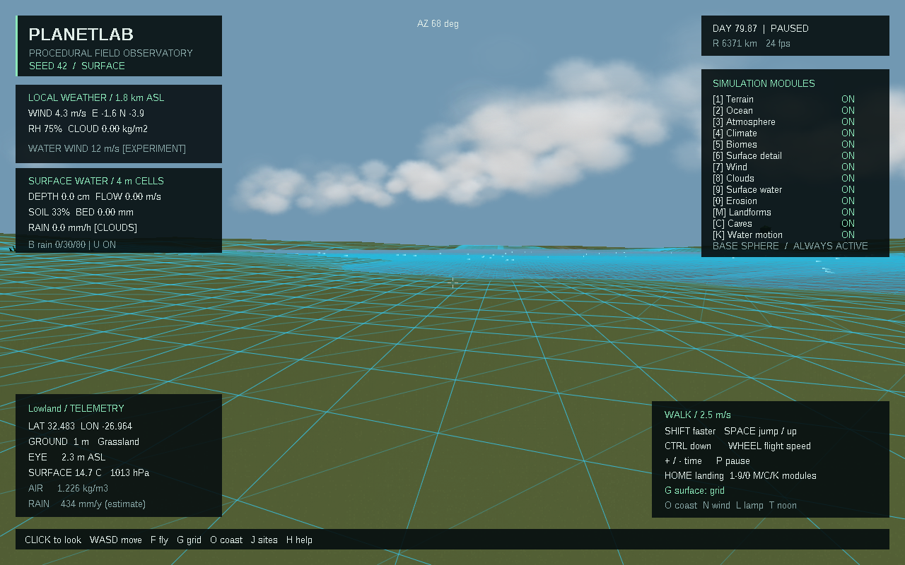
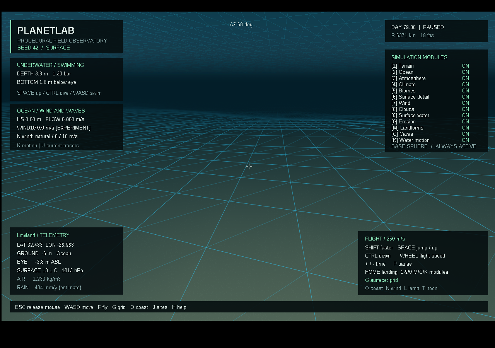
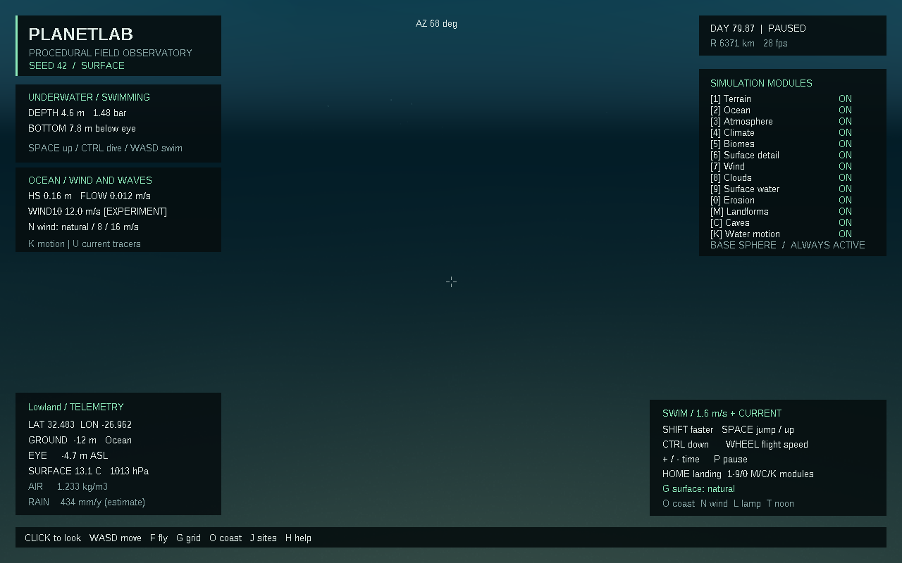

# Скачать PlanetLab 0.7.0

- [Готовая программа для Windows 10/11 x64](https://github.com/ballentarepuonatrij-del/procedural_world_system/raw/refs/heads/main/releases/PlanetLab-0.7.0-win64.zip).
- [Исходники C++20 для Visual Studio 2026](https://github.com/ballentarepuonatrij-del/procedural_world_system/raw/refs/heads/main/releases/PlanetLab-0.7.0-source.zip).

Распакуйте архив и запустите `PlanetLab/PlanetLab.exe`. Щёлкните в окне для обзора мышью, используйте WASD; F включает полёт, Tab — обзор планеты. Консольный инструмент `planet_cli.exe` находится рядом.

**Новое в 0.7.0:** ветер создаёт волны и течение. Поверхность воды движется, течение сносит пловца. Можно зайти с берега, плавать, погружаться и всплывать; под водой видны дно, глубина и давление. Новый модуль Water motion отключается отдельно. Горные формы, каньоны и пещеры предыдущей версии сохранены.

| Действие | Клавиша |
|---|---|
| Перейти на пологий берег | O |
| Погрузиться / всплыть | Ctrl / Пробел |
| Плыть / быстрее | WASD / Shift |
| Волны и ветровое воздействие на воду | K |
| Ветер для воды: естественный → 8 → 16 м/с | N |
| Перейти к пещере → каньону → горам → ущелью | J |
| Фонарь в пещере и под водой | L |
| Горные формы, плато, каньоны и ущелья | M |
| Пещеры | C |
| Сетка → каркас → обычная поверхность | G |
| Вернуться к посадке | Home |
| Поверхностная вода / эрозия | 9 / 0 |
| Частицы течения / добавочный дождь | U / B |
| Ветер / облака / частицы ветра | 7 / 8 / V |
| Пауза / продолжение модельного времени | P |

Для знакомства нажмите **O**, затем идите к воде. Когда станет достаточно глубоко, начнётся плавание. Удерживайте **Ctrl**, чтобы погрузиться, и **Пробел**, чтобы всплыть. **G** помогает рассмотреть дно, **L** управляет фонарём. **N** задаёт ветер для водного эксперимента; он не меняет движение облаков. Течение набирает скорость постепенно. Начальное модельное время — 1×; во время плавания ускорение автоматически ограничивается этим значением. Пауза замораживает водное поле, но сохраняет движение пловца.

Для быстрого старта из PowerShell в папке программы:

```powershell
.\PlanetLab.exe --coast --wind-m-s 12 --simulate-seconds 600
.\PlanetLab.exe --dive-depth 5 --wind-m-s 12 --simulate-seconds 600
```

Берег и вода с сеткой:



Подводный вид с сеткой дна и поверхности:



Подводное освещение и телеметрия:



Снимки получены из работающего приложения. Волны и океанское течение рассчитываются локально; глобальная циркуляция, приливы, прибой и физиология ныряния пока отсутствуют. Формулы, ограничения и результаты 80 проверок ядра — в [SCIENCE.md](../docs/SCIENCE.md) и [VALIDATION.md](../docs/VALIDATION.md).

Поставляется сборка MinGW-w64, проверенная в Wine. Проект поддерживает сборку Visual Studio 2026; нативная проверка MSVC v145 и Windows 10/11 в этой среде не выполнялась. Инструкция — в [основном README](../README.md).

Если GitHub показывает страницу ZIP-файла, нажмите **Download raw file**. Для закрытого репозитория сначала войдите в GitHub. Контрольные суммы — в [SHA256SUMS.txt](SHA256SUMS.txt). Архивы предыдущих версий сохранены.

Публикация облачной среды и загрузка этих файлов — отдельные действия: для запуска готового приложения достаточно ZIP из GitHub.
