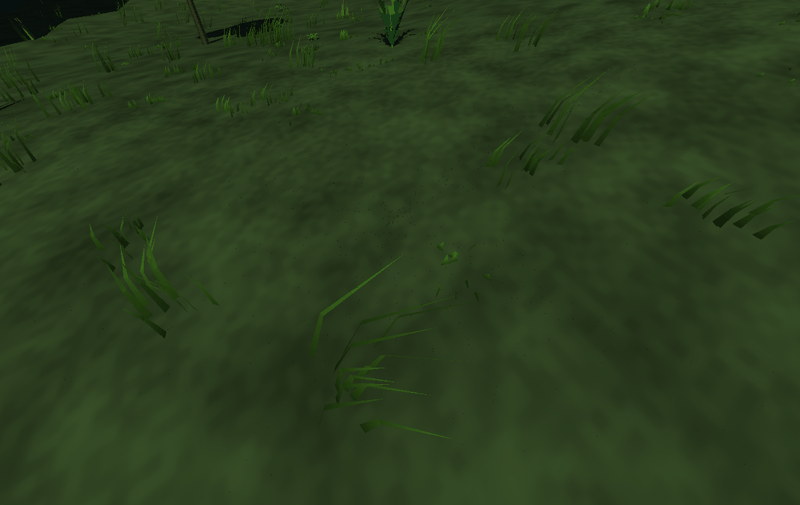
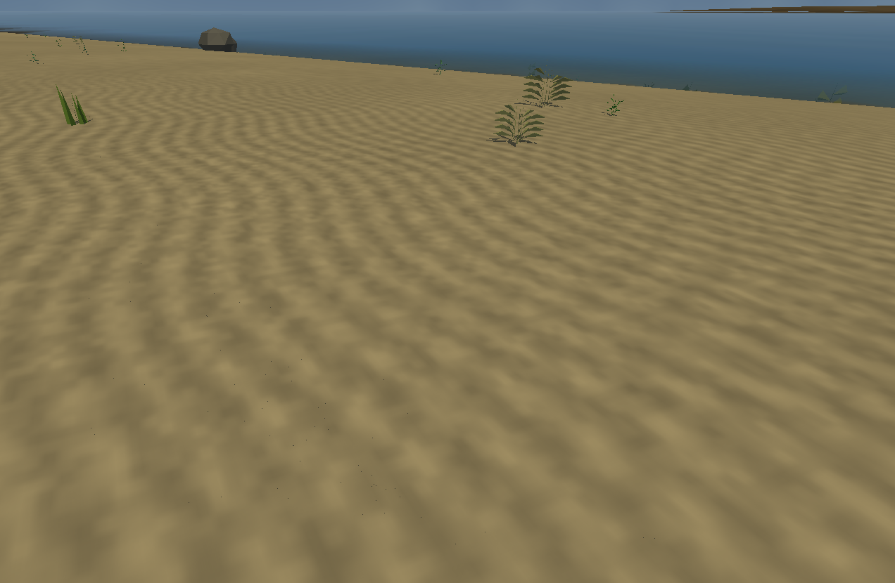
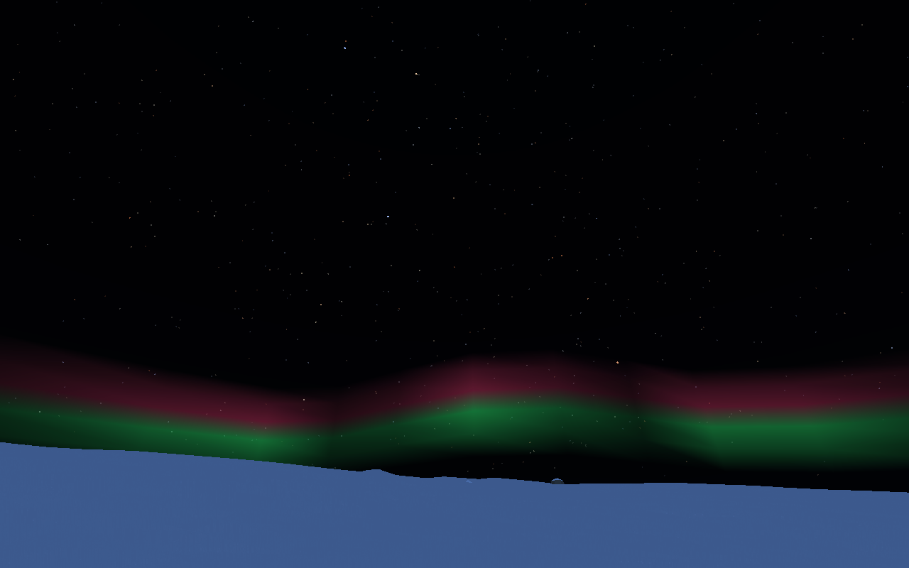
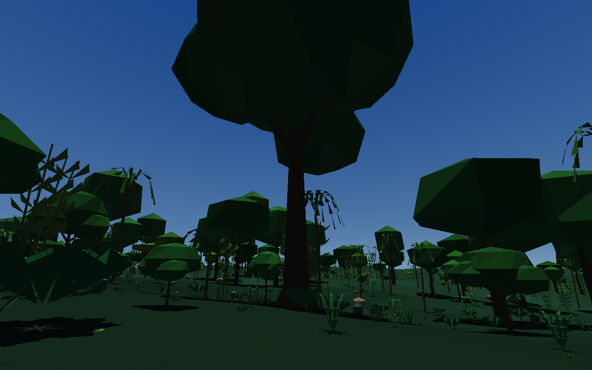
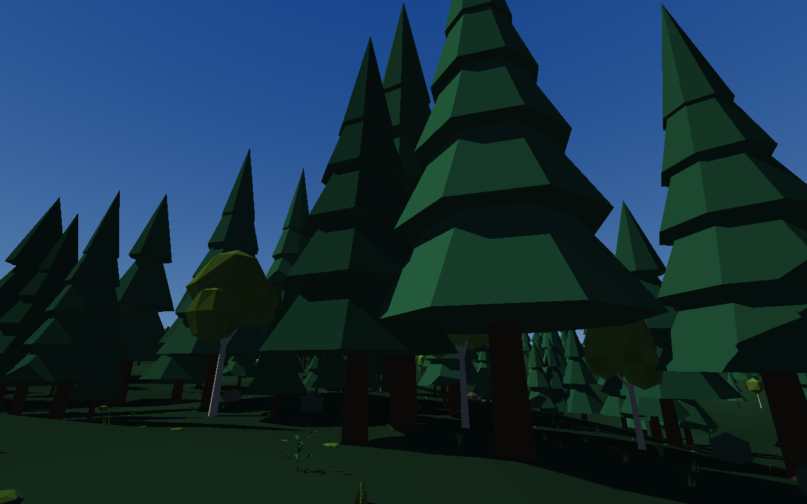
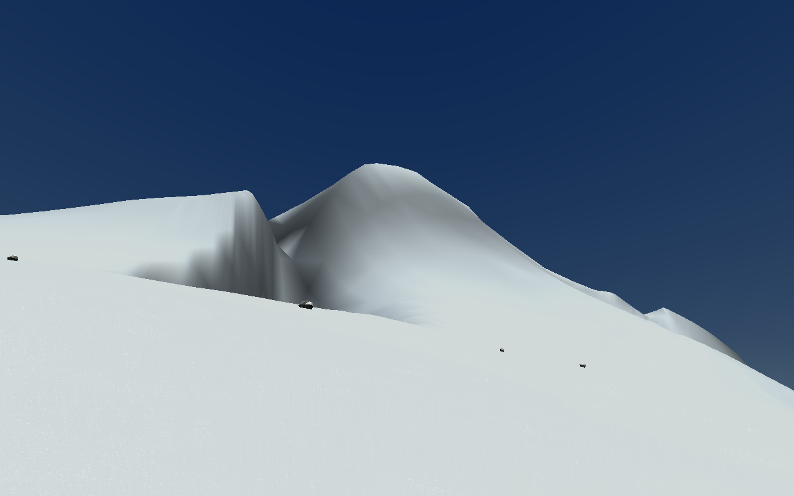

# Скачать PlanetLab 0.24.0

- [Готовая программа для Windows 10/11 x64](https://github.com/ballentarepuonatrij-del/procedural_world_system/raw/refs/heads/main/releases/PlanetLab-0.24.0-win64.zip).
- [Исходники C++20 для Visual Studio 2026](https://github.com/ballentarepuonatrij-del/procedural_world_system/raw/refs/heads/main/releases/PlanetLab-0.24.0-source.zip).

Распакуйте Windows-архив и запустите `PlanetLab/PlanetLab.exe`. ZIP — около **2,49 МБ**, распакованный комплект — **8,08 МБ**. Исходники — около **421 КБ**.

**Новое:** оптимизация рек, озёр и моря. Участки вне поля зрения пропускают расчёт освещения и отрисовку; общие вершины рек рассчитываются один раз; поверхность водоёмов передаётся в OpenGL пакетом; глубина переиспользуется между изменениями гидрологии. Волны и отражения продолжают обновляться каждый кадр. Видимая сетка, материалы, трава и тени сохранены. Измерения относительно 0.23.0 — в [PERFORMANCE.md](../docs/PERFORMANCE.md).

Для проверки: `PlanetLab.exe --river stream`, `--river river`, `--landmark lake` или `--coast`. **F7** переключает речные маршруты, **F4** — водоёмы, **O** ведёт на побережье, **P** включает паузу. **Ctrl+U** скрывает интерфейс.

Низкая и высокая трава с ветром и контактами из 0.23.0, материалы скалы, почвы, песка и снега с намоканием из 0.22.0 сохранены. Физика передвижения и формат мира не изменены; сохранения 0.21–0.23 совместимы. **F5/F9** — быстрый слот, ручные и автоматический слоты доступны в настройках. **Esc** освобождает курсор, повторное нажатие открывает настройки. Новых DLL и внешних текстур нет.

Поставляется MinGW-w64-сборка, проверенная в Wine 10. Нативные MSVC v145, Windows 10/11 и аппаратный GPU здесь не проверялись. [Проверки](../docs/VALIDATION.md), [контрольные суммы](SHA256SUMS.txt), [полное управление](../README.md).

Если GitHub показывает страницу ZIP, нажмите **Download raw file**. Предыдущие архивы сохранены: [Windows 0.23.0](PlanetLab-0.23.0-win64.zip), [исходники 0.23.0](PlanetLab-0.23.0-source.zip), [Windows 0.22.0](PlanetLab-0.22.0-win64.zip), [исходники 0.22.0](PlanetLab-0.22.0-source.zip), [Windows 0.21.0](PlanetLab-0.21.0-win64.zip), [исходники 0.21.0](PlanetLab-0.21.0-source.zip).

## Трава 0.23.0

Пять секунд ветра в работающем приложении:

## Материалы 0.22.0

## Снимки версии 0.21.0

## Снимки версии 0.20.0

## Снимки версии 0.19.0

