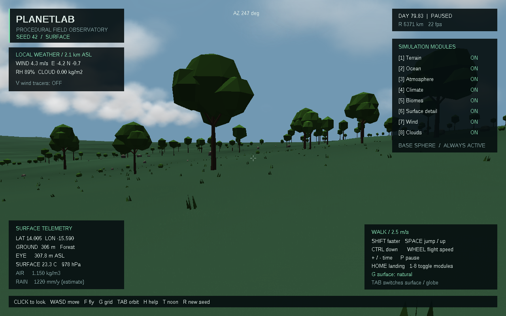
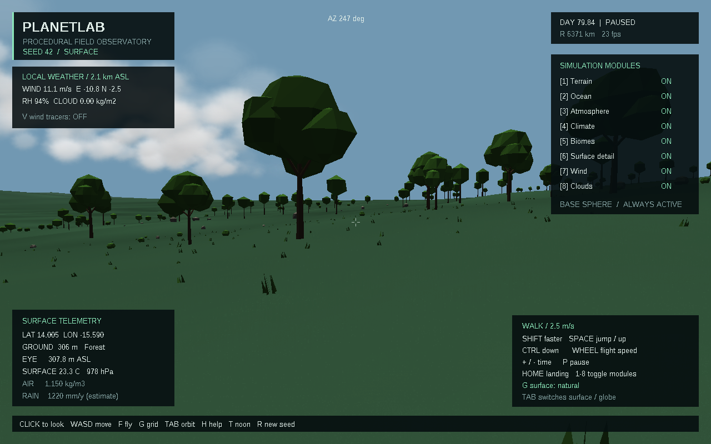
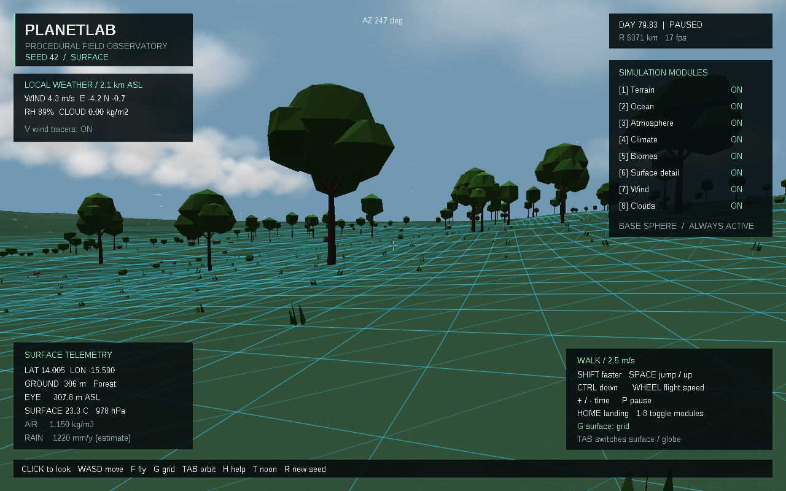

# Скачать PlanetLab 0.4.0

- [Готовая программа для Windows 10/11 x64](https://github.com/ballentarepuonatrij-del/procedural_world_system/raw/refs/heads/main/releases/PlanetLab-0.4.0-win64.zip).
- [Исходники C++20 для Visual Studio 2026](https://github.com/ballentarepuonatrij-del/procedural_world_system/raw/refs/heads/main/releases/PlanetLab-0.4.0-source.zip).

Распакуйте архив и запустите `PlanetLab/PlanetLab.exe`. Щёлкните в окне для обзора мышью, используйте WASD; F включает полёт, Tab — обзор планеты. Консольный инструмент `planet_cli.exe` находится рядом.

**Новое в 0.4.0:** локальный ветер, движение и изменение облаков, перенос пара и облачной воды, конденсация и испарение с обменом теплом. Модель ведёт водный баланс; визуальные частицы облаков получают плотность и скорость из расчёта.

| Действие | Клавиша |
|---|---|
| Ветер | 7 |
| Облака и перенос влаги | 8 |
| Частицы ветра | V |
| Пауза / продолжение модельного времени | P |
| Скорость времени | + / − |
| Сетка → каркас → обычная поверхность | G |

Скорость времени по умолчанию — 60×; её можно уменьшить до 1×. При работающем ветре максимум — 600×. Модули 1–6 сохраняют прежние функции. На паузе отключение и включение облаков возвращает то же состояние. T устанавливает солнечный полдень, R создаёт новый мир и сбрасывает погоду.

Начальное облачное поле:

Та же точка через 10 модельных минут:

Сетка поверхности и частицы ветра:

Снимки получены из кадрового буфера приложения. Погода рассчитывается в локальном слое; глобальный прогноз, движение рек и эрозия почвы пока не реализованы. Формулы, допущения и результаты тестов описаны в [SCIENCE.md](../docs/SCIENCE.md) и [VALIDATION.md](../docs/VALIDATION.md).

Если GitHub показывает страницу ZIP-файла, нажмите **Download raw file**. Для закрытого репозитория сначала войдите в GitHub. Контрольные суммы — в [SHA256SUMS.txt](SHA256SUMS.txt). Архивы предыдущих версий сохранены.

Инструкция для Visual Studio 2026 находится в [основном README](../README.md). Публикация облачной среды и загрузка файлов в GitHub выполняются отдельно.
