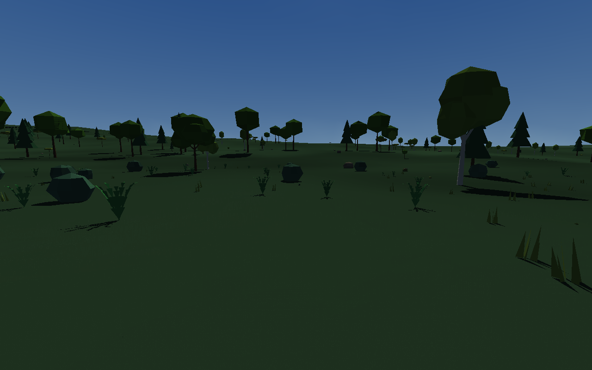
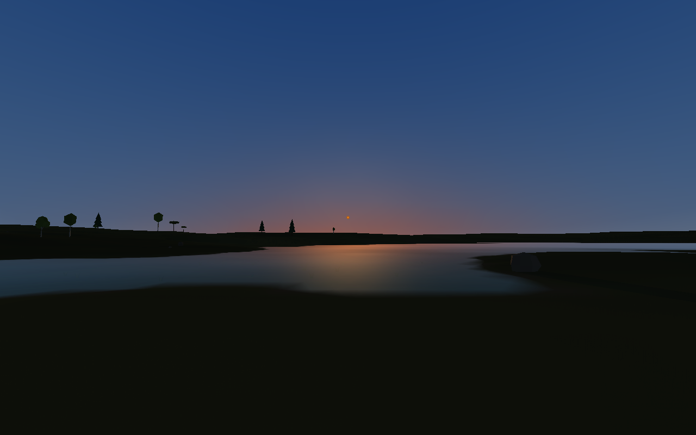
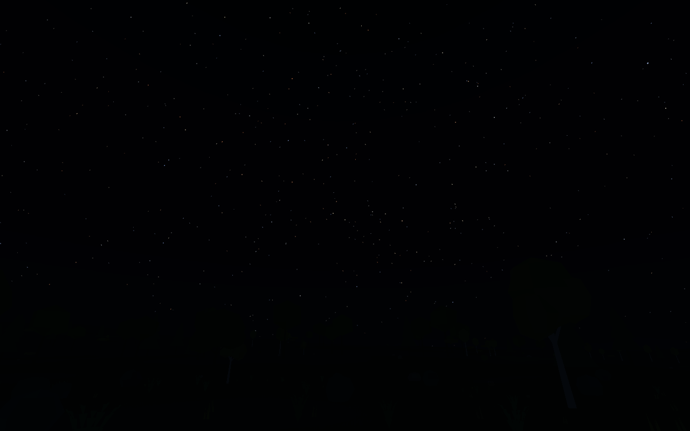
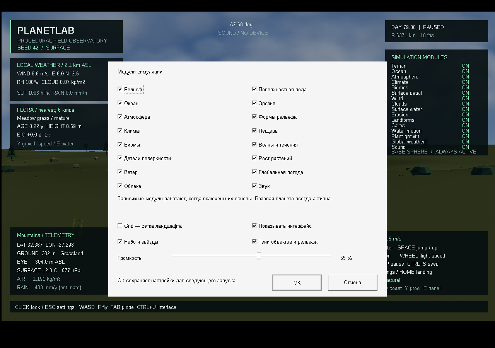

# Скачать PlanetLab 0.12.0

- [Готовая программа для Windows 10/11 x64](https://github.com/ballentarepuonatrij-del/procedural_world_system/raw/refs/heads/main/releases/PlanetLab-0.12.0-win64.zip).
- [Исходники C++20 для Visual Studio 2026](https://github.com/ballentarepuonatrij-del/procedural_world_system/raw/refs/heads/main/releases/PlanetLab-0.12.0-source.zip).

Windows-архив занимает 1,96 МБ, распакованная программа с CLI и документацией — 6,73 МБ.

Распакуйте ZIP и запустите `PlanetLab/PlanetLab.exe`. Щёлкните в окне для обзора мышью, используйте WASD. Консольный инструмент `planet_cli.exe` находится рядом.

**Новое в 0.12.0:** солнечные тени от камней, растительности и ближнего рельефа; небо по времени суток и погоде; процедурные звёзды и слабая холодная ночная подсветка. Солнце, прямой свет и направление теней согласованы с орбитой. При низком Солнце тени удлиняются, облачность ослабляет свет, вода отражает цвет неба.







| Действие | Управление |
|---|---|
| Освободить захваченный курсор | Esc |
| Открыть настройки при свободном курсоре | Esc ещё раз |
| Небо и звёзды, тени, модули, Grid, громкость | Окно настроек → ОК |
| Скрыть / вернуть весь интерфейс | Ctrl+U |
| Вернуться к солнечному полудню; пауза | T; P |
| Ускорить / замедлить модельное время | + / − |
| Ввести конкретный seed | Ctrl+S |
| Поверхность / глобус | Tab |
| Вращать глобус | Двигать мышь с зажатой ПКМ |
| Переместиться в выбранную точку | ЛКМ по планете → подтвердить «Да» |
| Ходьба / полёт; берег; роща | F; O; X |
| Посетить ураган → циклон → грозу | F2 |
| Погодный слой глобуса | F3 |

Небо и тени включены по умолчанию, Grid выключена. **ОК** применяет и сохраняет настройки; Отмена, Esc и крестик закрывают окно без изменений. Настройки находятся в `%LOCALAPPDATA%\PlanetLab\settings.ini` и восстанавливаются при запуске. Настройки версии 0.11 совместимы. Выключение неба скрывает его изображение, сохраняя расчёт освещения.



Для осмотра ночного неба запустите из папки программы:

```powershell
.\PlanetLab.exe --grove --no-clouds --solar-hour 0 --look 90 25 --paused
```

Нажмите Ctrl+U, чтобы убрать интерфейс, и P для продолжения времени. Ночная поверхность намеренно тёмная. Звёзды вымышленные; их движение согласовано со звёздными сутками. Экранная яркость учитывает приближённую адаптацию к темноте, без фотометрической калибровки.

Тени жёсткие, от центра солнечного диска: учитываются объекты в радиусе 240 м и ближний рельеф в пределах 1200 м. Мягкая полутень и тени на прозрачной воде пока отсутствуют. Если OpenGL-драйвер не предоставляет 8-битный stencil-буфер, тени отключаются с уведомлением в HUD. На слабом компьютере их можно выключить в настройках.

В окне Seed допустимы числа от `0` до `18446744073709551615`. **Смена seed сбрасывает текущее состояние симуляции.** Сохранение погоды, положения исследователя, эрозии и возраста растений между сеансами пока не реализовано.

Поставляется MinGW-w64-сборка. Проверены 133 проверки ядра, санитайзеры, дневные/ночные сцены и интерактивное управление в Wine. Нативные MSVC v145 и Windows 10/11 здесь не проверялись. Подробности — в [VALIDATION.md](../docs/VALIDATION.md), модели — в [SCIENCE.md](../docs/SCIENCE.md), инструкция сборки и все клавиши — в [основном README](../README.md).

Если GitHub показывает страницу ZIP, нажмите **Download raw file**. Для закрытого репозитория сначала войдите в GitHub. Контрольные суммы — в [SHA256SUMS.txt](SHA256SUMS.txt). Предыдущие архивы сохранены, в том числе [Windows 0.11.0](PlanetLab-0.11.0-win64.zip), [исходники 0.11.0](PlanetLab-0.11.0-source.zip) и [пример процедурной грозы](audio/thunder-0.10.0.wav).

Публикация облачной среды и скачивание приложения — отдельные действия: для запуска достаточно ZIP из GitHub.
