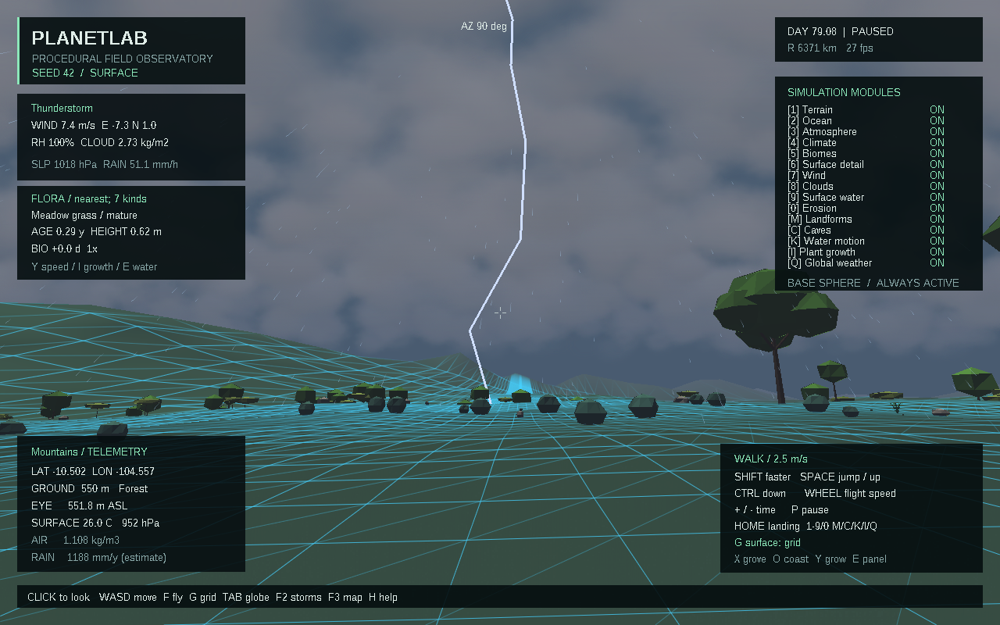
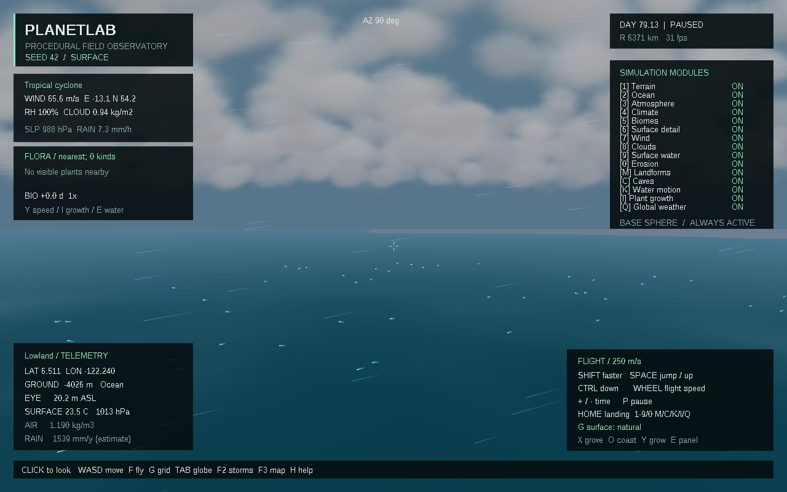
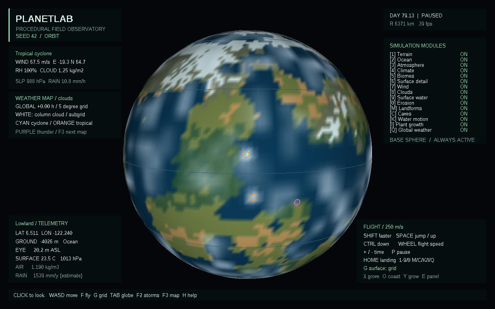
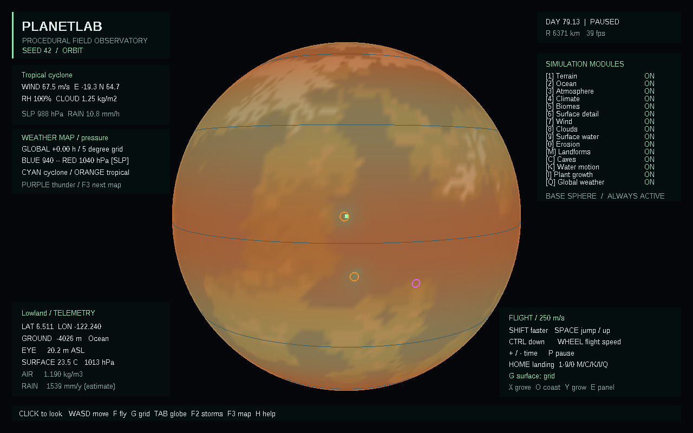

# Скачать PlanetLab 0.9.0

- [Готовая программа для Windows 10/11 x64](https://github.com/ballentarepuonatrij-del/procedural_world_system/raw/refs/heads/main/releases/PlanetLab-0.9.0-win64.zip).
- [Исходники C++20 для Visual Studio 2026](https://github.com/ballentarepuonatrij-del/procedural_world_system/raw/refs/heads/main/releases/PlanetLab-0.9.0-source.zip).

Распакуйте ZIP и запустите `PlanetLab/PlanetLab.exe`. Щёлкните в окне для обзора мышью, используйте WASD. Консольный инструмент `planet_cli.exe` находится рядом.

**Новое в 0.9.0:** глобальная сетка влаги, перемещающиеся циклоны, ураганный ветер над тёплым морем, грозы с дождём и молниями. Погода связана с местными облаками, стоком и волнами. Есть три погодных слоя глобуса и отдельный модуль Global weather.

| Действие | Клавиша |
|---|---|
| Посетить тропический циклон → внетропический циклон → грозу | F2 |
| Поверхность / глобус | Tab |
| Слой глобуса: облака → давление → ветер → выключен | F3 |
| Глобальная погода | Q |
| Ветер / облака, влага и молнии | 7 / 8 |
| Ускорение / замедление времени | + / − |
| Пауза / продолжение модели | P |
| Панель растений / воды с волнами и дождём | E |
| Ходьба / полёт | F |
| Берег; погрузиться / всплыть | O; Ctrl / Пробел |
| Роща; молодые растения; ускорить рост | X; Z; Y |
| Сетка → каркас → обычная поверхность | G |

Начните с **F2**: над морем включится полёт в области сильного ветра. Нажмите **Tab → F3** для карты давления. Ещё два перехода F2 приведут к грозе. Погода развивается и вдали от наблюдателя; начальные системы уже имеют разный возраст. Дождь и молнии останавливаются вместе с моделью по P.

Гроза у поверхности:

Тропический циклон над морем:

Облака и расположение погодных систем:

Диагностический слой давления на уровне моря:

Все снимки получены из работающего приложения. Быстрый запуск: `PlanetLab.exe --storm thunderstorm` или `PlanetLab.exe --storm hurricane --simulate-seconds 120`. Параметр `--global-hours 6 --globe` показывает глобальное состояние через шесть часов; местная предыстория воды и растений при таком предварительном расчёте не интегрируется.

Это упрощённая научная модель с проверяемыми балансами. Глобальная атмосфера не решает полные трёхмерные уравнения; траектории и интенсивность вихрей параметризованы, молнии визуальны. Штормовой нагон, снег, град, торнадо и повреждение растений пока отсутствуют. Подробности и результаты проверок — в [SCIENCE.md](../docs/SCIENCE.md) и [VALIDATION.md](../docs/VALIDATION.md).

Поставляется MinGW-w64-сборка; прошли 104 проверки ядра и проверки интерфейса в Wine. Нативные MSVC v145 и Windows 10/11 в этой среде не проверялись. Инструкция для Visual Studio 2026 — в [основном README](../README.md).

Если GitHub показывает страницу ZIP, нажмите **Download raw file**. Для закрытого репозитория сначала войдите в GitHub. Контрольные суммы — в [SHA256SUMS.txt](SHA256SUMS.txt). Предыдущие архивы сохранены.

Публикация облачной среды и скачивание приложения — отдельные действия: для запуска достаточно ZIP из GitHub.
