# Скачать PlanetLab 0.22.0

- [Готовая программа для Windows 10/11 x64](https://github.com/ballentarepuonatrij-del/procedural_world_system/raw/refs/heads/main/releases/PlanetLab-0.22.0-win64.zip).
- [Исходники C++20 для Visual Studio 2026](https://github.com/ballentarepuonatrij-del/procedural_world_system/raw/refs/heads/main/releases/PlanetLab-0.22.0-source.zip).

Распакуйте Windows-архив и запустите `PlanetLab/PlanetLab.exe`. ZIP — около **2,45 МБ**, распакованный комплект — **7,96 МБ**. Исходники — около **390 КБ**.

**Новое:** процедурные материалы скалы, почвы, песка и снега. Трещины, комья, песчаная рябь и снежное зерно смешиваются по уклону, климату и покрову. Мокрая поверхность темнеет и отражает направленный свет; влажность следует дождю, стоку, испарению и талой воде. Рисунок остаётся на месте при движении и не растягивается на стенах.

Для осмотра: **J** — скалы и пещеры, **F10** — побережья, **F12** — снег. `--rain-mm-h 120 --simulate-seconds 120` запускает дождевой опыт. **Ctrl+U** скрывает интерфейс. Внешние текстуры и дополнительные DLL не нужны. На старом OpenGL действует резервное смешивание цветов; полный рисунок и блики требуют GLSL 1.20.

Фоновая подгрузка и адаптивная подробность сохранены; микродеталь плавно исчезает в быстром полёте. Физика передвижения и формат снимков мира не изменены. Сохранения 0.21.0 совместимы. **F5/F9** — быстрый слот, ручные и автоматический слоты доступны в настройках. **Esc** освобождает курсор, повторное нажатие открывает настройки с вкладками; гамма и яркость сохраняют предпросмотр.

Поставляется MinGW-w64-сборка, проверенная в Wine 10. Нативные MSVC v145, Windows 10/11 и аппаратный GPU здесь не проверялись. [Проверки](../docs/VALIDATION.md), [производительность](../docs/PERFORMANCE.md), [контрольные суммы](SHA256SUMS.txt), [полное управление](../README.md).

Если GitHub показывает страницу ZIP, нажмите **Download raw file**. Предыдущие архивы сохранены: [Windows 0.21.0](PlanetLab-0.21.0-win64.zip), [исходники 0.21.0](PlanetLab-0.21.0-source.zip). Публикация облачной среды не требуется для запуска программы.

## Материалы 0.22.0

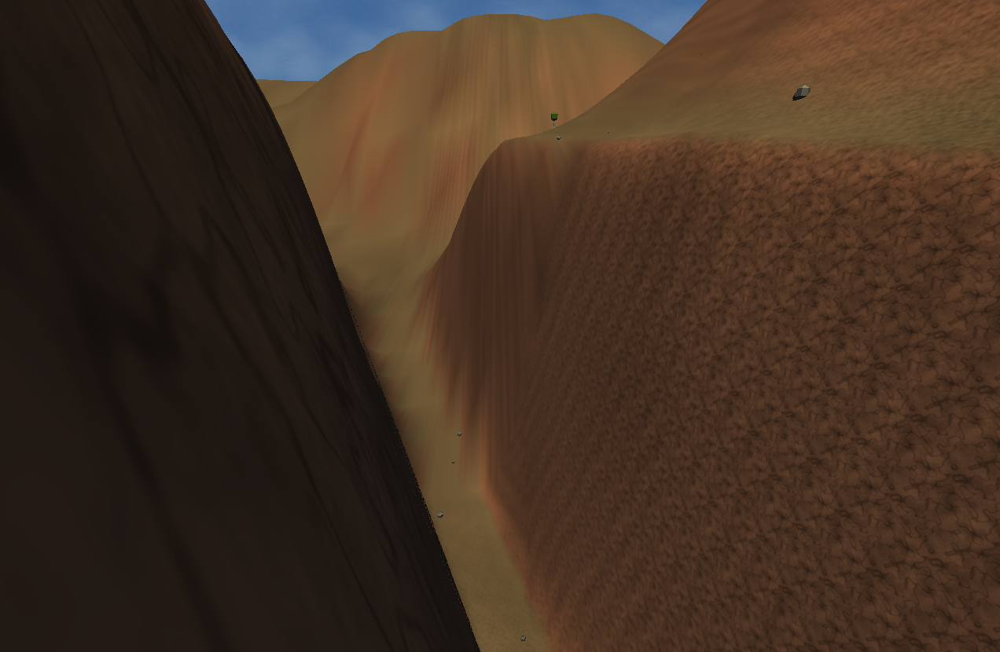

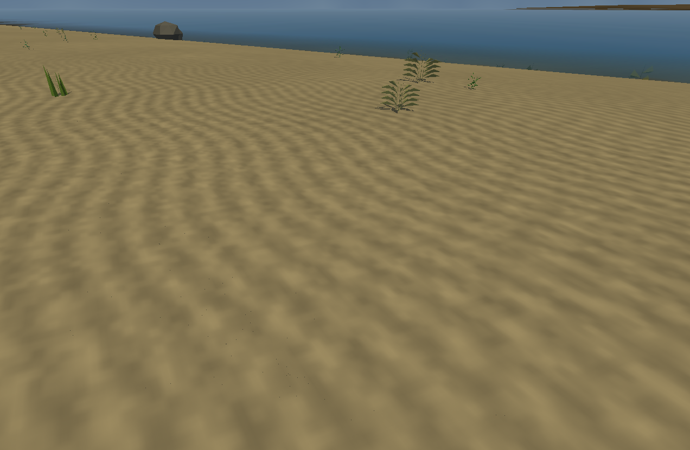

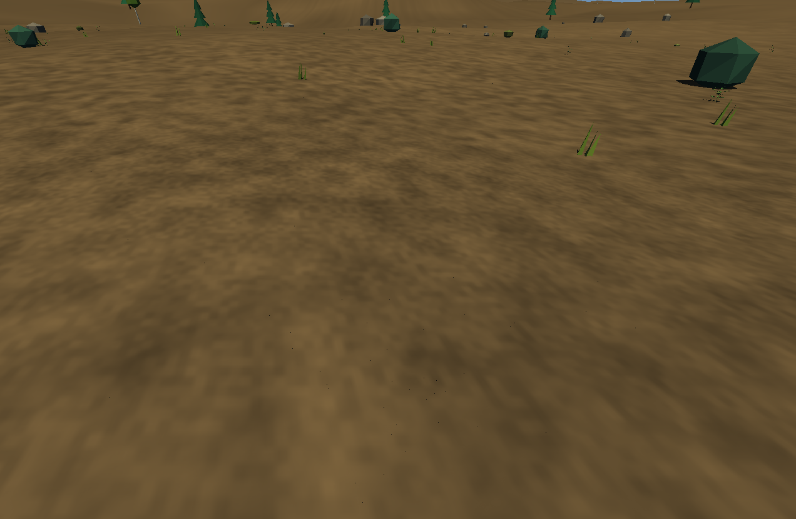

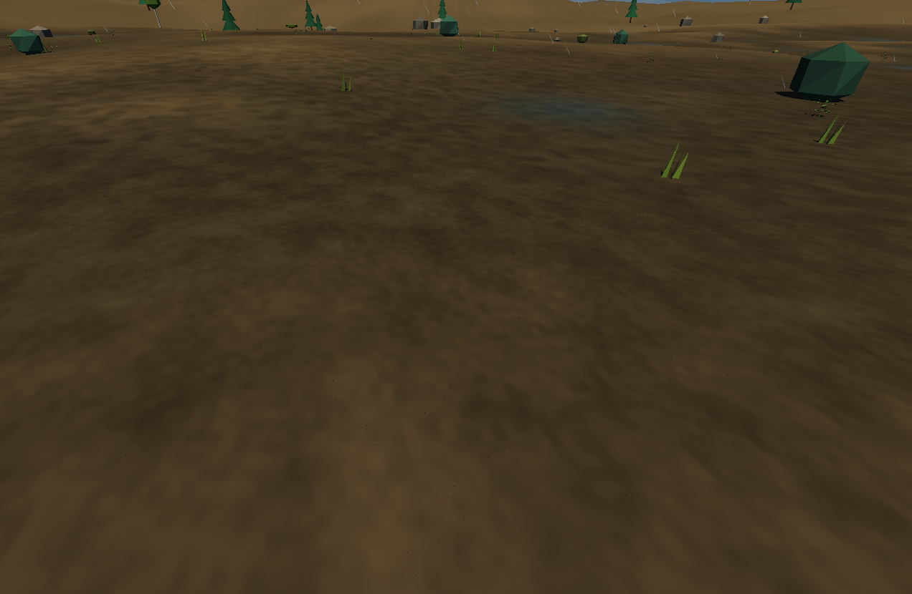

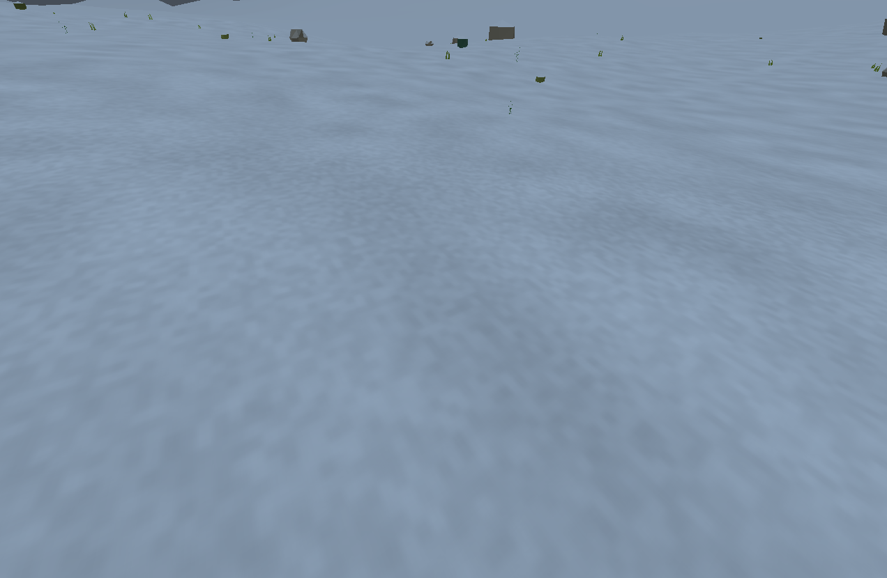

## Снимки версии 0.21.0

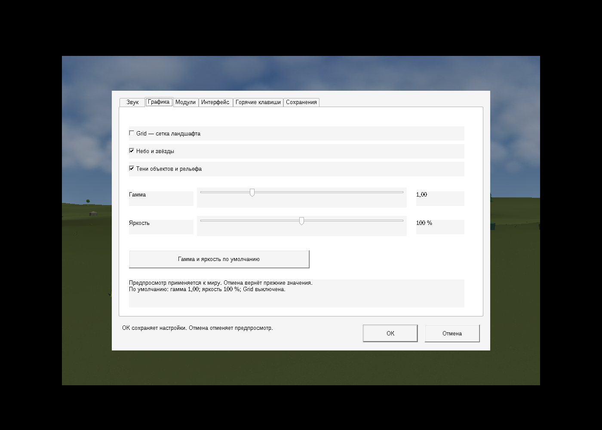

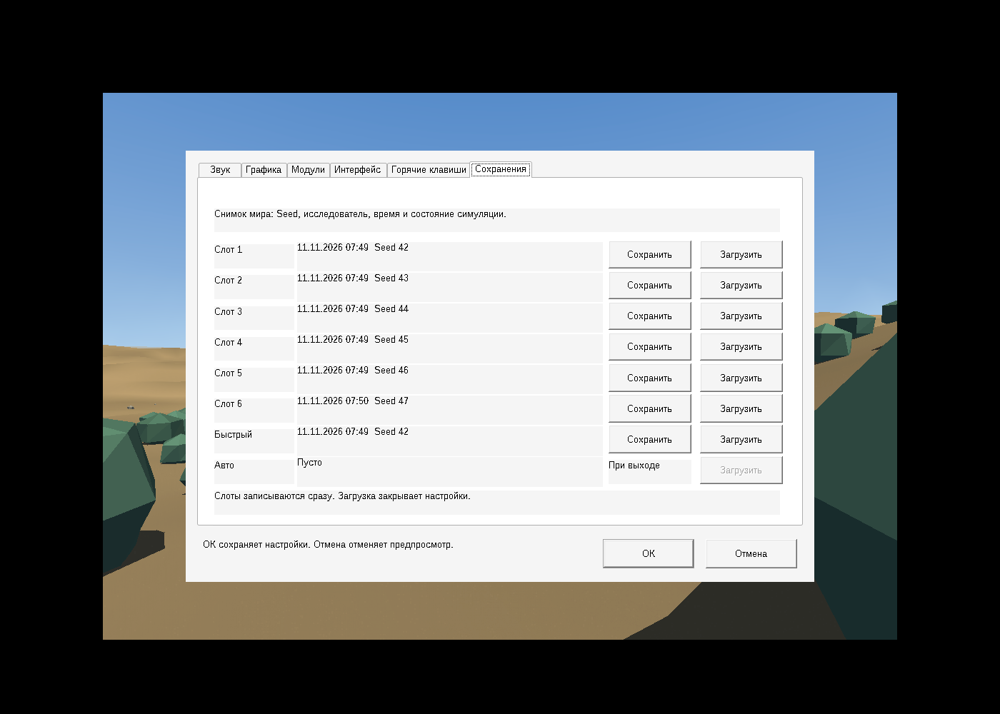

## Снимки версии 0.20.0

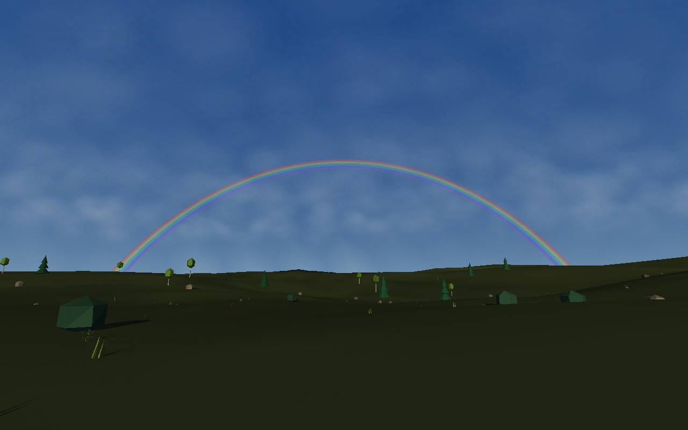

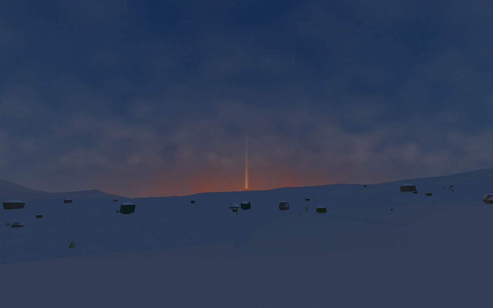

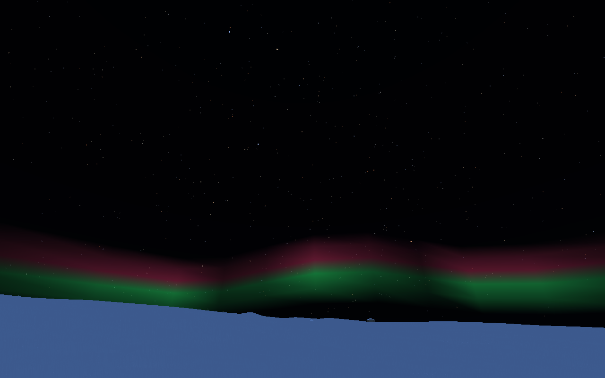

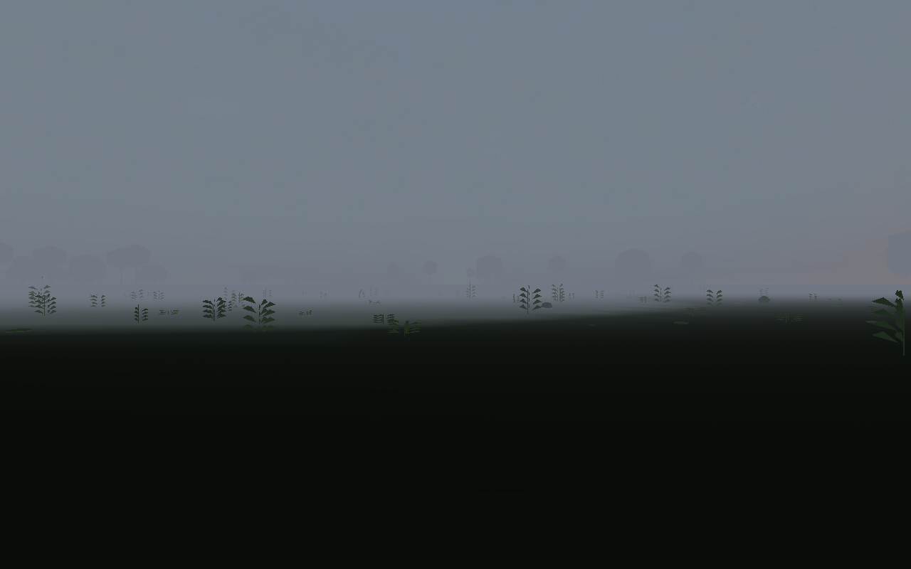

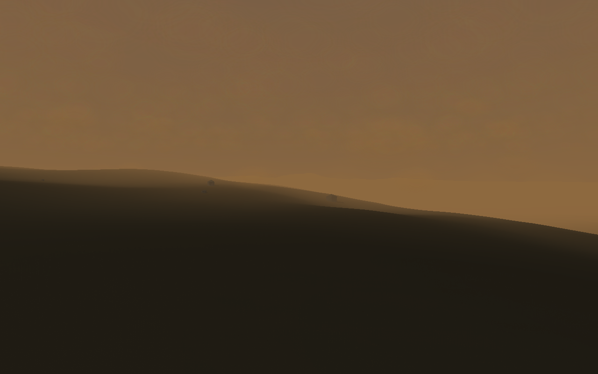

## Снимки версии 0.19.0

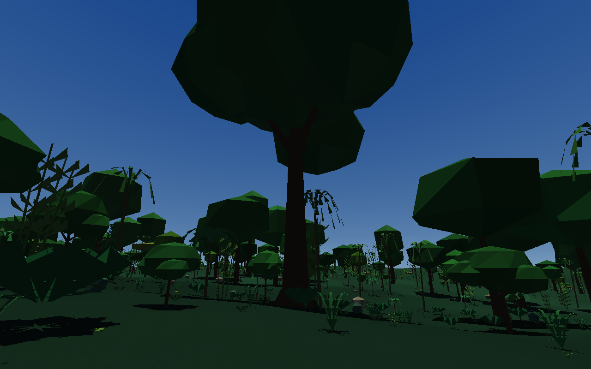

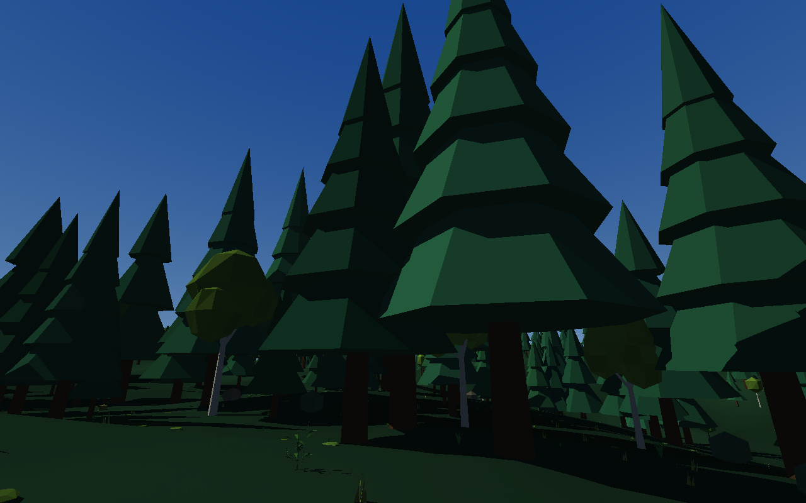

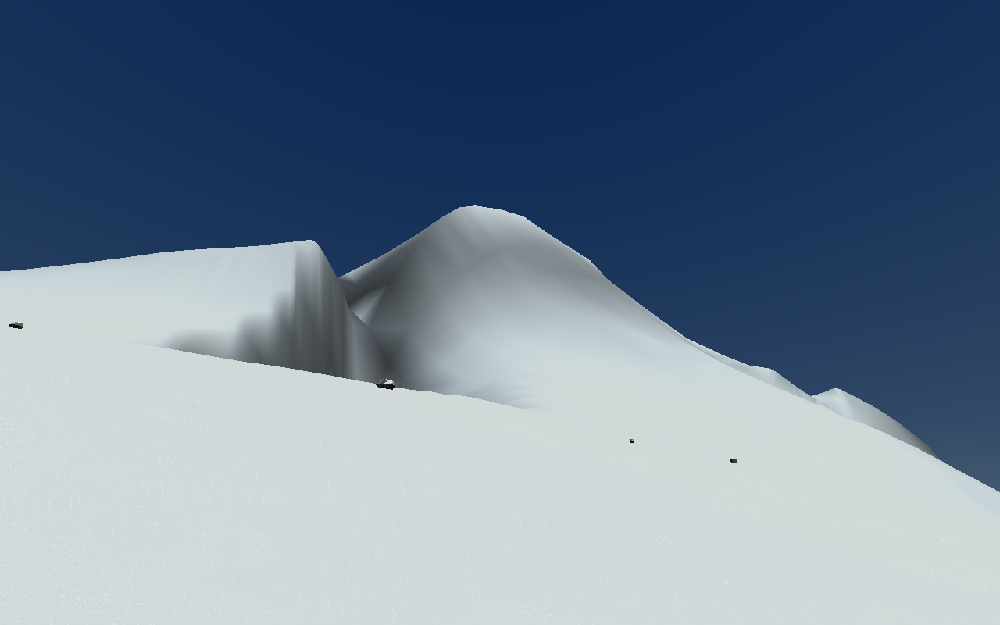

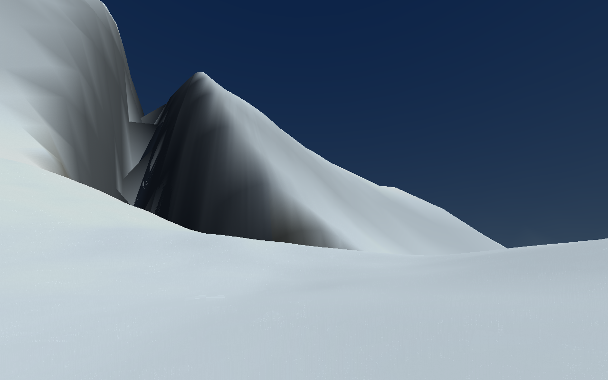
