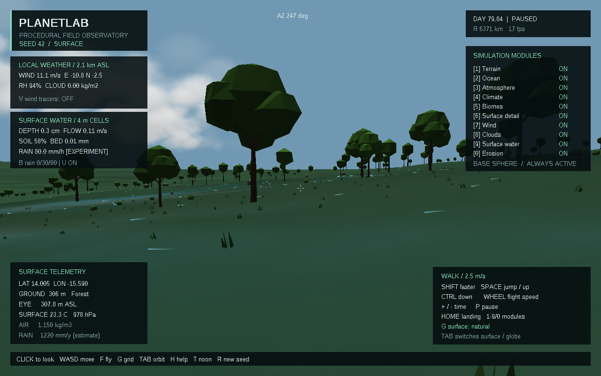
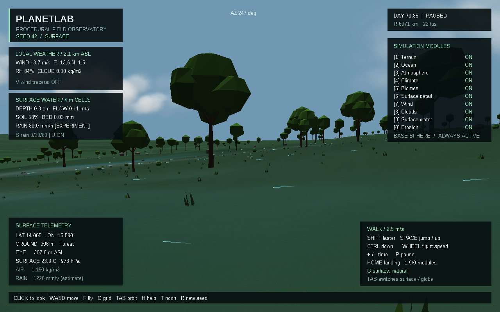
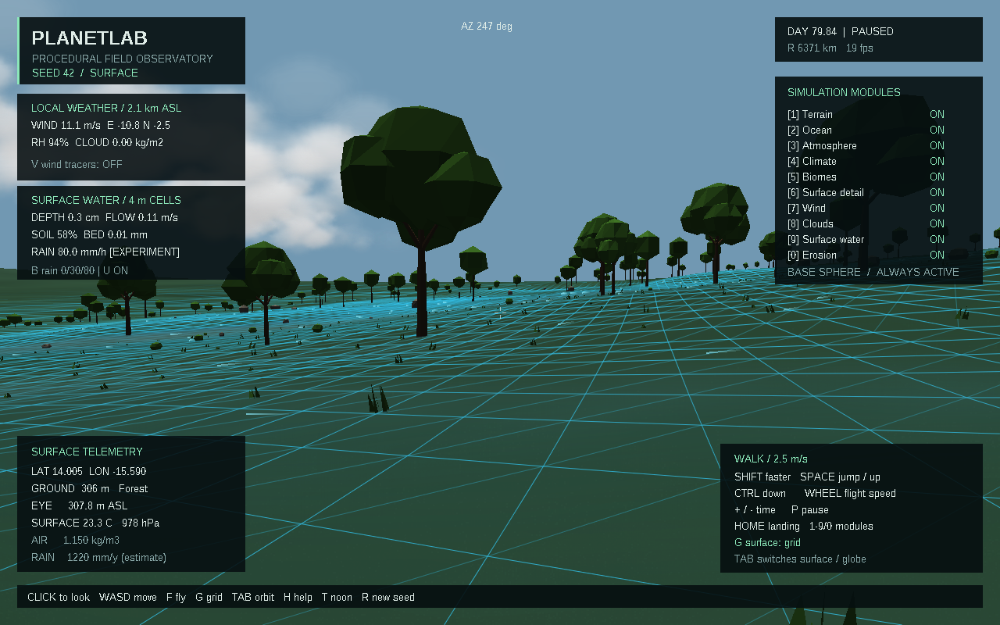

# Скачать PlanetLab 0.5.0

- [Готовая программа для Windows 10/11 x64](https://github.com/ballentarepuonatrij-del/procedural_world_system/raw/refs/heads/main/releases/PlanetLab-0.5.0-win64.zip).
- [Исходники C++20 для Visual Studio 2026](https://github.com/ballentarepuonatrij-del/procedural_world_system/raw/refs/heads/main/releases/PlanetLab-0.5.0-source.zip).

Распакуйте архив и запустите `PlanetLab/PlanetLab.exe`. Щёлкните в окне для обзора мышью, используйте WASD; F включает полёт, Tab — обзор планеты. Консольный инструмент `planet_cli.exe` находится рядом.

**Новое в 0.5.0:** поверхностный сток, лужи в понижениях, впитывание в грунт, перенос взвеси, эрозия и осаждение. Осадки из облаков поступают на землю; грунт и вода имеют отдельные проверяемые балансы массы. Область расчёта — 256 × 256 м, шаг — 4 м.

| Действие | Клавиша |
|---|---|
| Поверхностная вода | 9 |
| Эрозия и осаждение | 0 |
| Частицы течения | U |
| Добавочный дождь: 0 → 30 → 80 → 0 мм/ч | B |
| Ветер / облака | 7 / 8 |
| Частицы ветра | V |
| Пауза / продолжение модельного времени | P |
| Скорость времени | + / − |
| Сетка → каркас → обычная поверхность | G |

Для наблюдения стока нажмите B дважды: добавится экспериментальный ливень 80 мм/ч. При начальной скорости 60× десять реальных секунд соответствуют десяти модельным минутам. Третий раз B выключает добавочный дождь; вода остаётся и продолжает стекать. U показывает частицы течения, P останавливает расчёт. Максимальное ускорение с водой — 120×. Эрозия не ускоряется отдельно; её небольшие изменения видны в миллиметрах на панели BED.

После 10 модельных минут ливня 80 мм/ч:

Та же точка через 20 модельных минут:

Сетка поверхности и частицы течения:

Снимки получены из кадрового буфера приложения. Дождь в этих опытах задан пользователем; естественные осадки продолжают поступать из погодного слоя. Глобальная сеть рек, снег/лёд, динамика океана и сохранение состояния между запусками ещё не реализованы. Формулы, допущения и результаты тестов — в [SCIENCE.md](../docs/SCIENCE.md) и [VALIDATION.md](../docs/VALIDATION.md).

Если GitHub показывает страницу ZIP-файла, нажмите **Download raw file**. Для закрытого репозитория сначала войдите в GitHub. Контрольные суммы — в [SHA256SUMS.txt](SHA256SUMS.txt). Архивы предыдущих версий сохранены.

Инструкция для Visual Studio 2026 находится в [основном README](../README.md). Публикация облачной среды и загрузка этих файлов — отдельные действия: для запуска готового приложения достаточно ZIP из GitHub.
