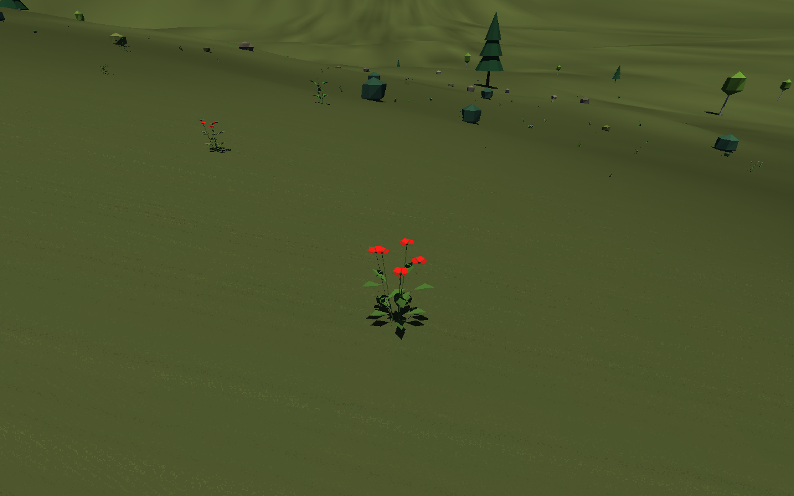
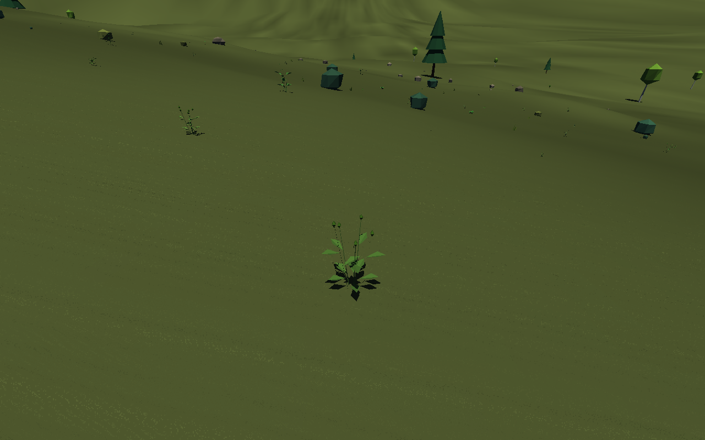

# Скачать PlanetLab 0.14.0

- [Готовая программа для Windows 10/11 x64](https://github.com/ballentarepuonatrij-del/procedural_world_system/raw/refs/heads/main/releases/PlanetLab-0.14.0-win64.zip).
- [Исходники C++20 для Visual Studio 2026](https://github.com/ballentarepuonatrij-del/procedural_world_system/raw/refs/heads/main/releases/PlanetLab-0.14.0-source.zip).

Windows-архив занимает 2,06 МБ, распакованная программа с CLI и документацией — 6,96 МБ.

Распакуйте ZIP и запустите `PlanetLab/PlanetLab.exe`. Щёлкните в окне для обзора мышью, используйте WASD. Консольный инструмент `planet_cli.exe` находится рядом.

**Новое в 0.14.0:** сезонное цветение и шесть луговых трав — ромашка (нивяник), красный клевер, полевой мак, василёк, кипрей и лютик. Всего в модели 18 типов растительности. Цветки отличаются формой и окраской, появляются после бутонов и сменяются семенными головками. Сроки зависят от возраста, тепла местного климата и полушария. Цветение есть также у прежних цветковых растений, включая морскую траву; у хвойных, папоротников и водорослей цветков нет.



Тот же участок до раскрытия цветков и после цветения; это снимки программы при разных биологических днях, с одинаковым возрастом растений:




| Действие | Управление |
|---|---|
| Посетить луг с несколькими цветущими видами | F8 |
| Ускорить рост и биологический сезон: обычный → день/с → 30 дней/с | Y |
| Начать опыт с молодыми растениями в текущем сезоне | Z |
| Панель растения: вид, возраст и фаза цветения | E |
| Пауза / продолжить модельное время | P |
| Освободить захваченный курсор / открыть настройки при свободном курсоре | Esc / Esc ещё раз |
| Модули, Grid, небо, тени, громкость | Настройки → ОК |
| Скрыть / вернуть весь интерфейс | Ctrl+U |
| Ввести конкретный seed | Ctrl+S |
| Поверхность / глобус; вращать глобус; переместиться с подтверждением | Tab; ПКМ; ЛКМ |
| Большая река → обычная река → ручей; берег; роща | F7; O; X |
| Слой глобуса: облака → давление → ветер → реки → течения → выключен | F3 |
| Ходьба / полёт; погружение / всплытие; частицы течения | F; Ctrl / Пробел; U |
| Посетить ураган → циклон → грозу; солнечный полдень | F2; T |

Для быстрого осмотра цветущего луга стандартного seed:

```powershell
.\PlanetLab.exe --seed 42 --meadow --flora-day 125
.\PlanetLab.exe --seed 42 --meadow --young-flora --flora-day 0 --grow-days 150
.\planet_cli.exe --seed 42 --meadow --flora-day 125
```

На старте обычного сеанса часть лугов ещё не цветёт. F8 переносит к растениям, сохраняя сезон; Y позволяет дождаться цветения. «Рост растений» управляет и ростом, и цветением. `--flora-day` выбирает биологический день без изменения возраста; `--grow-days` затем продвигает возраст и сезон вместе. Погода и солнце при ускорении Y сохраняют прежний темп. Z сбрасывает возраст, а текущий биологический сезон сохраняет.

Настройки находятся в `%LOCALAPPDATA%\PlanetLab\settings.ini`; прежние настройки совместимы. Новые модули в этом выпуске не добавлены. **ОК** применяет и сохраняет выбор; Отмена, Esc и крестик закрывают окно без изменений. Grid при первом запуске выключена. Смена seed сбрасывает состояние мира; положение, погода, эрозия и биологический возраст между запусками пока не сохраняются. Расширение списка трав меняет видовой состав прежних seed.

Цветение использует опорный годовой климат и накопленное тепло. Реакция на отдельные заморозки, опылители, генетика и перенос семян пока не рассчитываются. Формулы и ограничения — в [SCIENCE.md](../docs/SCIENCE.md).

Поставляется MinGW-w64-сборка, проверенная в Wine. Нативные MSVC v145 и Windows 10/11 здесь не проверялись. Результаты проверок — в [VALIDATION.md](../docs/VALIDATION.md), инструкция сборки и все клавиши — в [основном README](../README.md).

Если GitHub показывает страницу ZIP, нажмите **Download raw file**. Для закрытого репозитория сначала войдите в GitHub. Контрольные суммы — в [SHA256SUMS.txt](SHA256SUMS.txt). Предыдущие файлы сохранены: [Windows 0.13.0](PlanetLab-0.13.0-win64.zip), [исходники 0.13.0](PlanetLab-0.13.0-source.zip) и [пример процедурной грозы](audio/thunder-0.10.0.wav).

Публикация облачной среды и скачивание приложения — отдельные действия: для запуска достаточно ZIP из GitHub.
