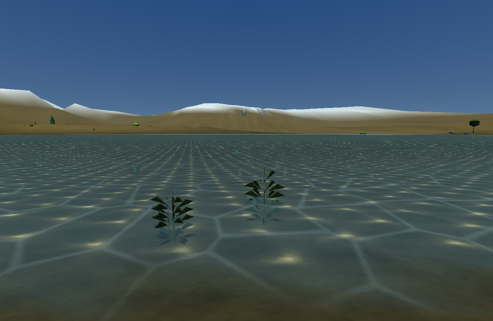
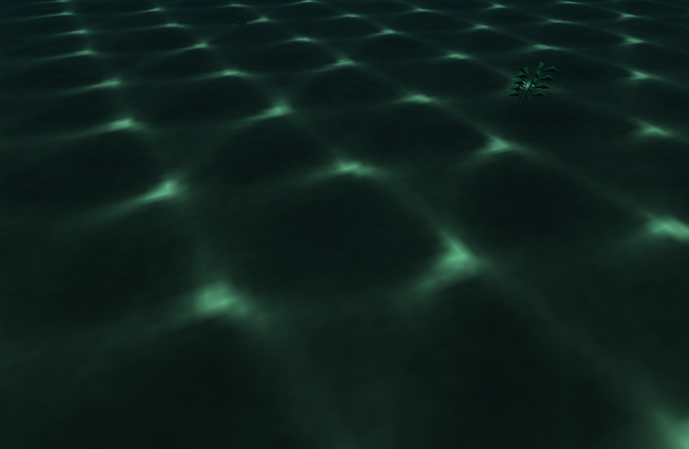
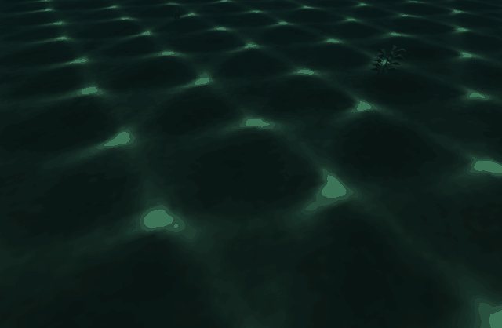
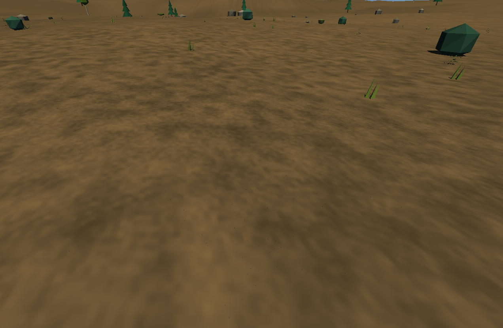
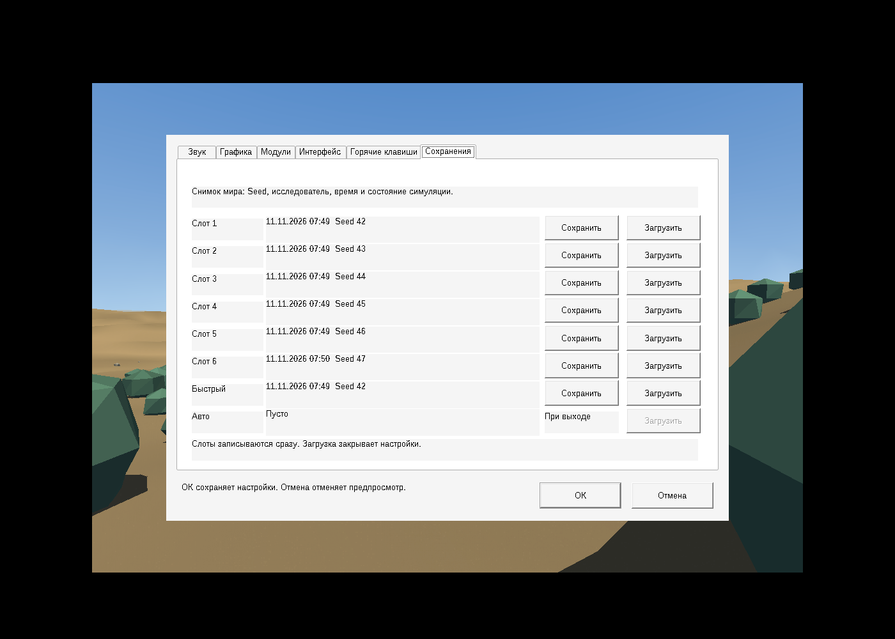
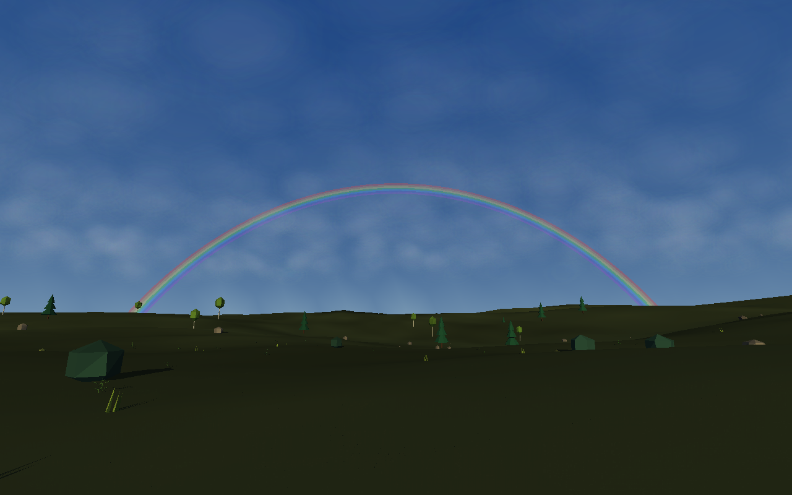
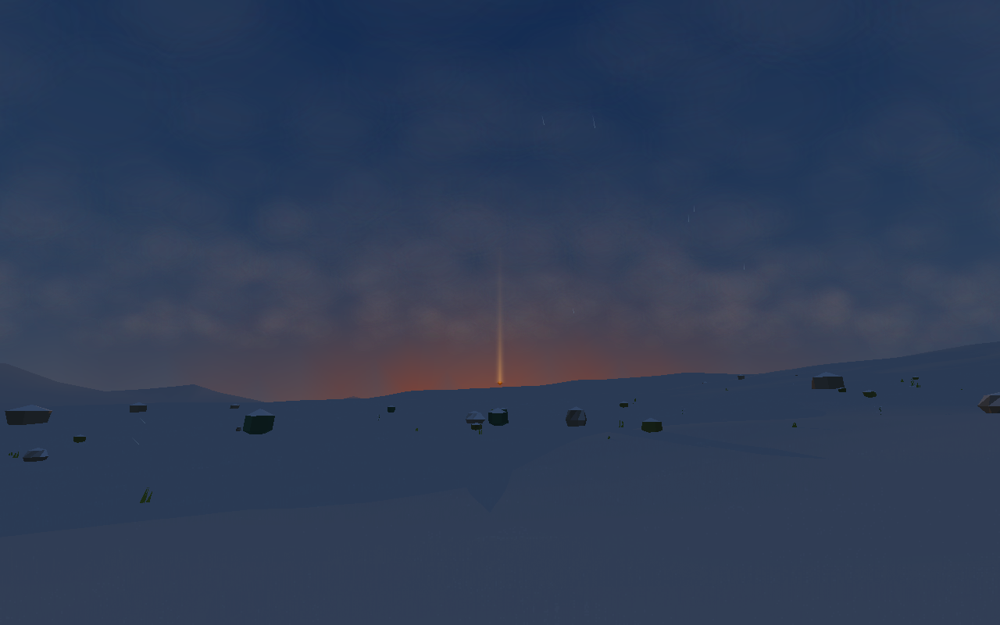
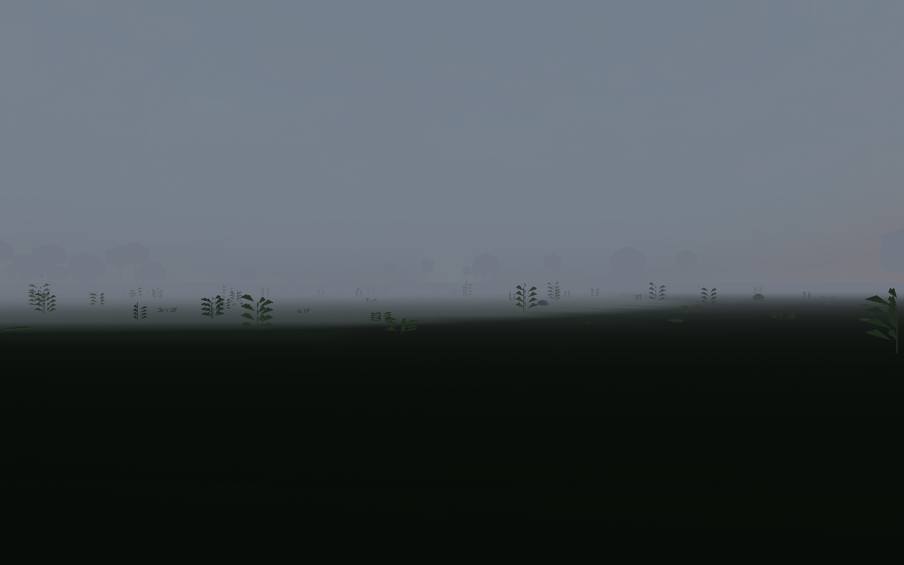

# Скачать PlanetLab 0.25.0

- [Программа для Windows 10/11 x64](https://github.com/ballentarepuonatrij-del/procedural_world_system/raw/refs/heads/main/releases/PlanetLab-0.25.0-win64.zip).
- [Исходники C++20 для Visual Studio 2026](https://github.com/ballentarepuonatrij-del/procedural_world_system/raw/refs/heads/main/releases/PlanetLab-0.25.0-source.zip).

Распакуйте Windows-архив и запустите `PlanetLab/PlanetLab.exe`. ZIP — около **2,53 МБ**, распакованный комплект — **8,19 МБ**; исходники — около **452 КБ**.

**Новое:** постепенное образование и таяние льда с учётом температуры, скрытой теплоты, солёности и течения; подавление волн, прозрачность, иней и процедурные трещины. Лёд от 10 см поддерживает исследователя и ограничивает всплытие снизу. Под водой и прозрачным льдом появились солнечные каустики: рисунок воды движется, ледяной микрорельеф остаётся неподвижным. Ночью, на суше и при высоком/быстром полёте эффект отключён.

**Попробовать:** `PlanetLab.exe --landmark pond --ice freeze --ice-hours 72`. Для взгляда снизу добавьте `--dive-depth 1`.

**I** — охлаждение / оттепель / местный климат; **Shift+I** — 24 часа только теплообмена при фиксированных погоде и течении. На тёплом пруду seed 42 нужны примерно три шага для несущего льда. **P** — пауза; **F5/F9** — быстрый слот; **F4** — водоёмы; **F7** — реки; **Ctrl+U** — интерфейс; **Esc** — курсор / настройки.

Старые слоты 0.21–0.24 читаются. Новые сохраняют температуру, лёд и опыт в формате 2, который старые EXE не читают. Для возврата к прежнему EXE потребуется отдельная копия старого слота.

Кэш и пакетная отрисовка воды из 0.24 сохранены. В программном рендерере включённые эффекты добавили около 3–12% к среднему времени кадра в контрольных сценах реки/озера/моря. `--no-caustics` отключает только световые узоры. GLSL 1.20 необязателен; `--basic-materials` включает цветной лёд без трещин и каустики. Новых DLL и внешних текстур нет. Разрушение льда под нагрузкой пока не моделируется; порог опоры — игровое правило.

Проверки: **248/248** в Linux и Windows-ядре, **33/33 CTest**, санитайзеры, совместимость сохранений, графические сцены и 40 сравнительных запусков производительности. Поставляется MinGW-w64-сборка, проверенная в Wine 10; нативные MSVC/Windows и аппаратный GPU здесь не проверялись. [Проверки](../docs/VALIDATION.md), [производительность](../docs/PERFORMANCE.md), [модель](../docs/SCIENCE.md), [SHA-256](SHA256SUMS.txt), [управление](../README.md).

Если GitHub показывает страницу ZIP, нажмите **Download raw file**. Предыдущие версии сохранены: [Windows 0.24.0](PlanetLab-0.24.0-win64.zip), [исходники 0.24.0](PlanetLab-0.24.0-source.zip), [Windows 0.23.0](PlanetLab-0.23.0-win64.zip), [исходники 0.23.0](PlanetLab-0.23.0-source.zip), [Windows 0.22.0](PlanetLab-0.22.0-win64.zip), [исходники 0.22.0](PlanetLab-0.22.0-source.zip), [Windows 0.21.0](PlanetLab-0.21.0-win64.zip), [исходники 0.21.0](PlanetLab-0.21.0-source.zip).

## Лёд и каустика 0.25.0

## Трава 0.23.0

Пять секунд ветра в работающем приложении:

## Материалы 0.22.0

## Снимки версии 0.21.0

## Снимки версии 0.20.0

## Снимки версии 0.19.0

