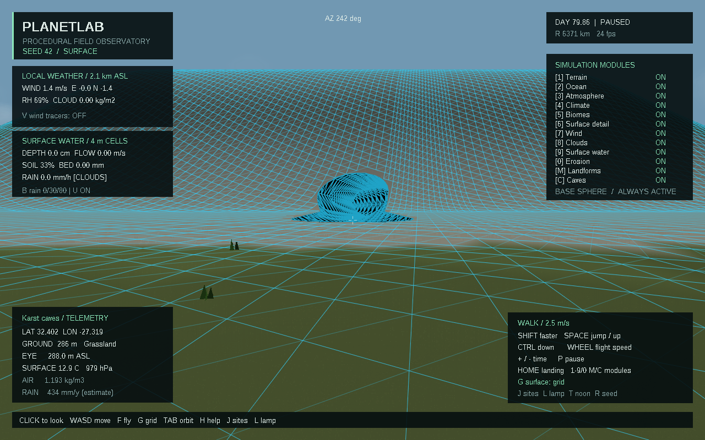
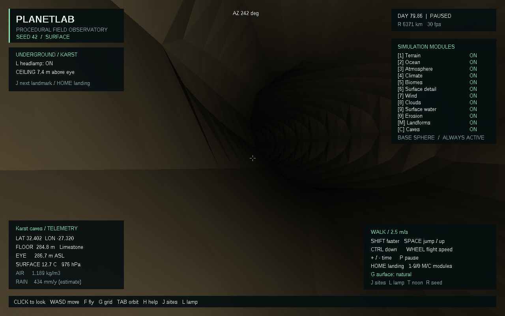
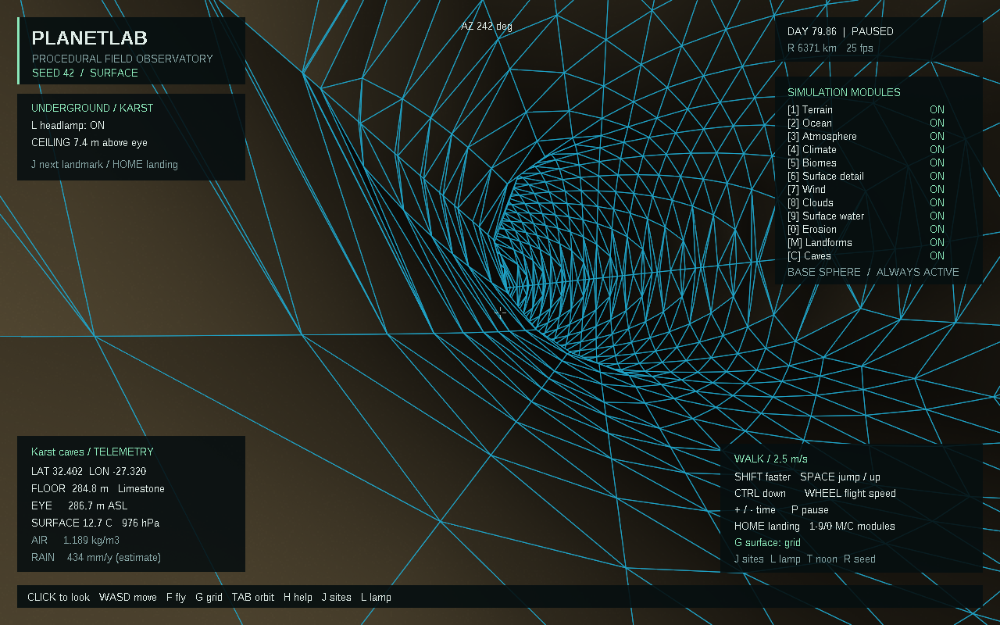
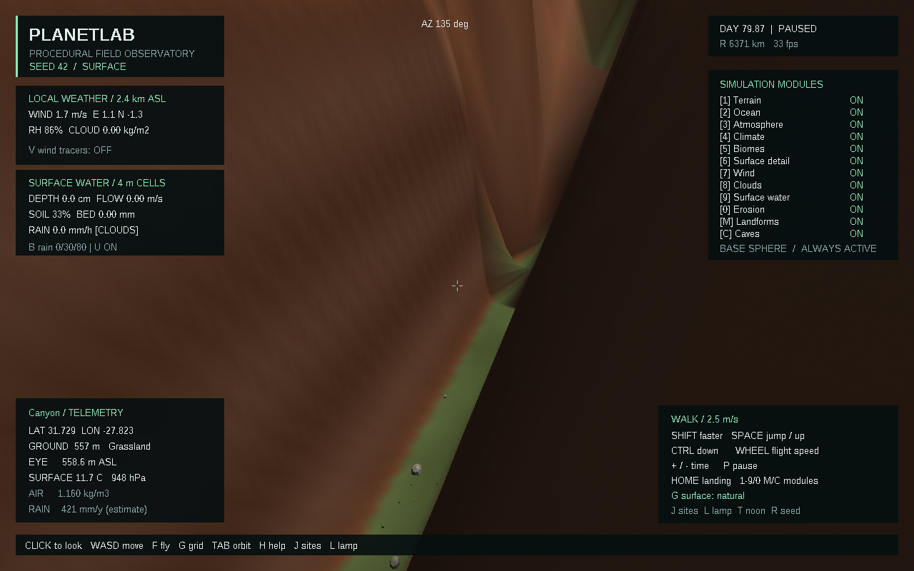
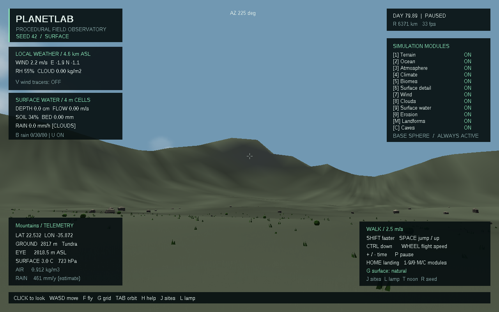

# Скачать PlanetLab 0.6.0

- [Готовая программа для Windows 10/11 x64](https://github.com/ballentarepuonatrij-del/procedural_world_system/raw/refs/heads/main/releases/PlanetLab-0.6.0-win64.zip).
- [Исходники C++20 для Visual Studio 2026](https://github.com/ballentarepuonatrij-del/procedural_world_system/raw/refs/heads/main/releases/PlanetLab-0.6.0-source.zip).

Распакуйте архив и запустите `PlanetLab/PlanetLab.exe`. Щёлкните в окне для обзора мышью, используйте WASD; F включает полёт, Tab — обзор планеты. Консольный инструмент `planet_cli.exe` находится рядом.

**Новое в 0.6.0:** горные гребни, плато с уступами, каньоны, ущелья и пещеры с настоящими входами, разветвлением и залами. В пещеры можно входить, исследовать их с фонарём и возвращаться наружу. Стены, пол и потолок участвуют в столкновениях. Два новых модуля можно отключить отдельно.

| Действие | Клавиша |
|---|---|
| Перейти к пещере → каньону → горам → ущелью | J |
| Фонарь | L |
| Горные формы, плато, каньоны и ущелья | M |
| Пещеры | C |
| Сетка → каркас → обычная поверхность | G |
| Вернуться к посадке | Home |
| Поверхностная вода / эрозия | 9 / 0 |
| Частицы течения / добавочный дождь | U / B |
| Ветер / облака / частицы ветра | 7 / 8 / V |
| Пауза / продолжение модельного времени | P |

Для знакомства нажмите **J** один раз: появитесь перед входом в пещеру. Идите вперёд, затем следуйте поворотам галереи; **L** управляет фонарём. Следующие нажатия J покажут другие формы ландшафта. При отключении C внутри пещеры наблюдатель возвращается наверх. Режим G показывает сетку как снаружи, так и внутри.

Вход с сеткой:

Галерея с фонарём:

Сетка стен и потолка:

Каньон:

Горная область:

Снимки получены из кадрового буфера приложения. Новые высотные формы меняют прежний мир при включённом M. Пещеры используют семейство процедурных галерей; геологическая эволюция, растворение, обвалы и подземные реки ещё не рассчитываются. Пещерный участок исключён из двумерного стока, его граница непроницаема. Формулы, ограничения и результаты проверок — в [SCIENCE.md](../docs/SCIENCE.md) и [VALIDATION.md](../docs/VALIDATION.md).

Поставляется сборка MinGW-w64, проверенная в Wine. Проект поддерживает сборку Visual Studio 2026; нативная проверка MSVC v145 и Windows 10/11 в этой среде не выполнялась. Инструкция — в [основном README](../README.md).

Если GitHub показывает страницу ZIP-файла, нажмите **Download raw file**. Для закрытого репозитория сначала войдите в GitHub. Контрольные суммы — в [SHA256SUMS.txt](SHA256SUMS.txt). Архивы предыдущих версий сохранены.

Публикация облачной среды и загрузка этих файлов — отдельные действия: для запуска готового приложения достаточно ZIP из GitHub.
