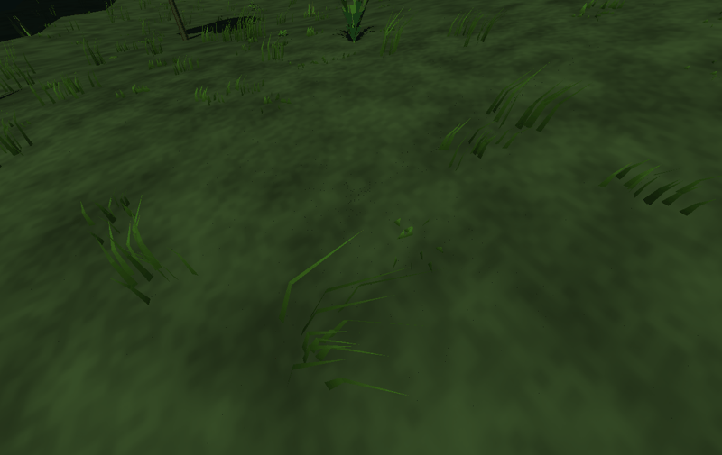
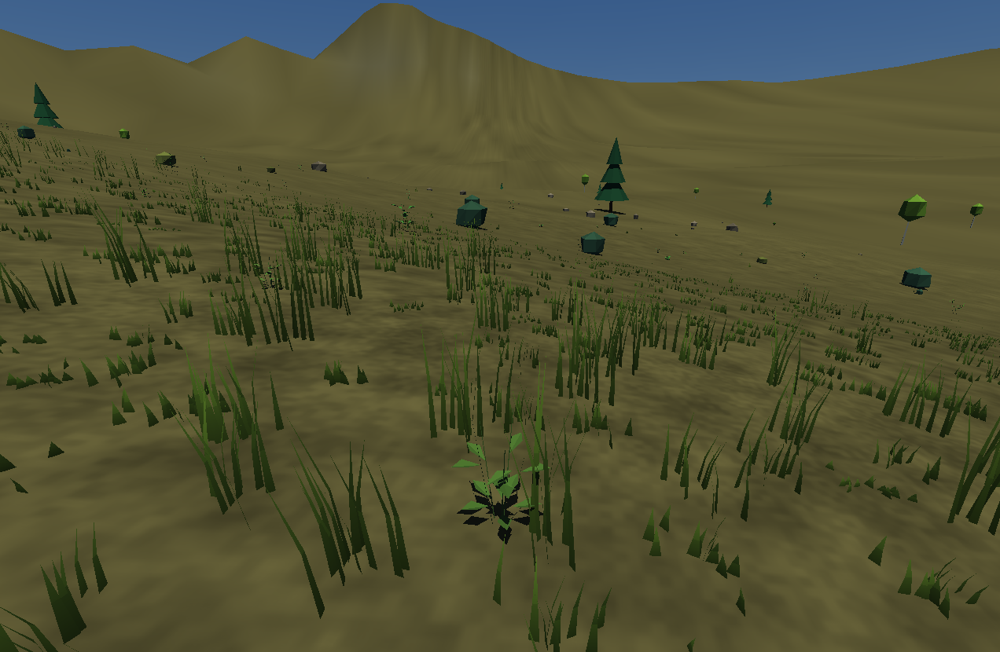
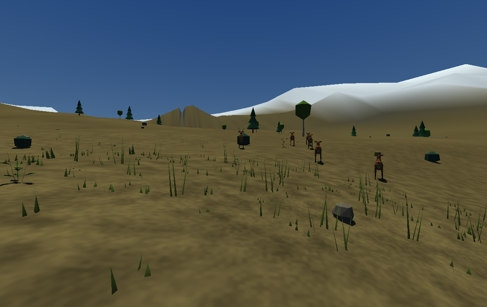

# Скачать PlanetLab 0.23.0

- [Готовая программа для Windows 10/11 x64](https://github.com/ballentarepuonatrij-del/procedural_world_system/raw/refs/heads/main/releases/PlanetLab-0.23.0-win64.zip).
- [Исходники C++20 для Visual Studio 2026](https://github.com/ballentarepuonatrij-del/procedural_world_system/raw/refs/heads/main/releases/PlanetLab-0.23.0-source.zip).

Распакуйте Windows-архив и запустите `PlanetLab/PlanetLab.exe`. ZIP — около **2,48 МБ**, распакованный комплект — **8,05 МБ**. Исходники — около **411 КБ**.

**Новое:** низкая и высокая трава, колебания от погодного ветра, упругое отклонение при проходе исследователя и оленей. Корни закреплены на грунте; после прохода трава выпрямляется. Распределение зависит от Seed, климата, уклона, леса и снега, рост — от возраста растений.

**F8** — луг, **F11** — наблюдение за стадом, **P** — пауза. На паузе передвижение остаётся доступно и раздвигает траву. Для запуска сразу на лугу: `PlanetLab.exe --meadow`. **Ctrl+U** скрывает интерфейс. Внешние текстуры и новые DLL не нужны.

Подготовка новых участков выполняется в фоне с ограниченной загрузкой за кадр; вдали и при быстром полёте покров упрощается. Изгиб — локальная модель пружин с затуханием, без обратного воздействия на передвижение и животных. Основной путь требует GLSL 1.20 с выборкой текстуры в вершинном шейдере; для старого OpenGL есть редкий ближний покров на CPU (`--basic-grass`). На программном OpenGL ходьба стала дороже примерно на 5–9 мс; измерения и ограничения приведены в [PERFORMANCE.md](../docs/PERFORMANCE.md).

Материалы скалы, почвы, песка и снега с намоканием из 0.22.0 сохранены. Формат мира не изменён, сохранения 0.21/0.22 совместимы; временные изгибы травы после загрузки сбрасываются. **F5/F9** — быстрый слот, ручные и автоматический слоты доступны в настройках. **Esc** освобождает курсор, повторное нажатие открывает настройки.

Поставляется MinGW-w64-сборка, проверенная в Wine 10. Нативные MSVC v145, Windows 10/11 и аппаратный GPU здесь не проверялись. [Проверки](../docs/VALIDATION.md), [контрольные суммы](SHA256SUMS.txt), [полное управление](../README.md).

Если GitHub показывает страницу ZIP, нажмите **Download raw file**. Предыдущие архивы сохранены: [Windows 0.22.0](PlanetLab-0.22.0-win64.zip), [исходники 0.22.0](PlanetLab-0.22.0-source.zip), [Windows 0.21.0](PlanetLab-0.21.0-win64.zip), [исходники 0.21.0](PlanetLab-0.21.0-source.zip).

## Трава 0.23.0

Пять секунд ветра в работающем приложении:

## Материалы 0.22.0

## Снимки версии 0.21.0

## Снимки версии 0.20.0

## Снимки версии 0.19.0

