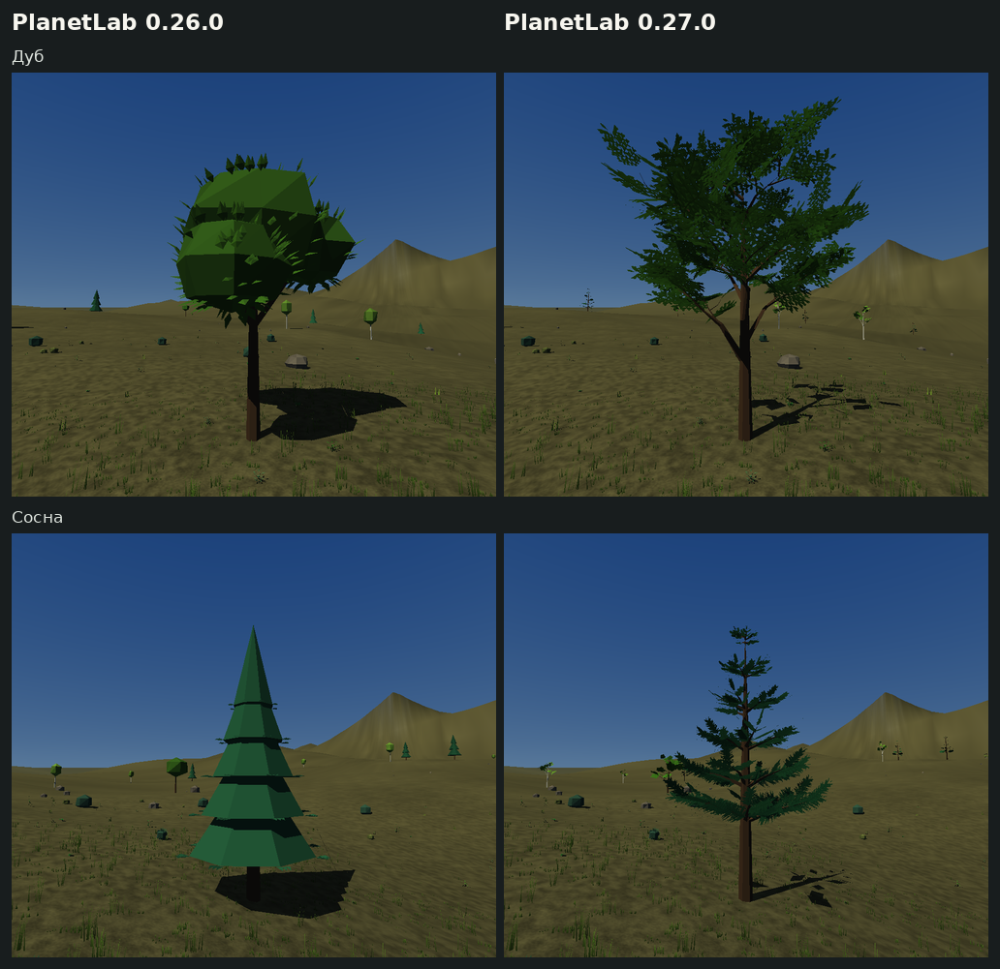
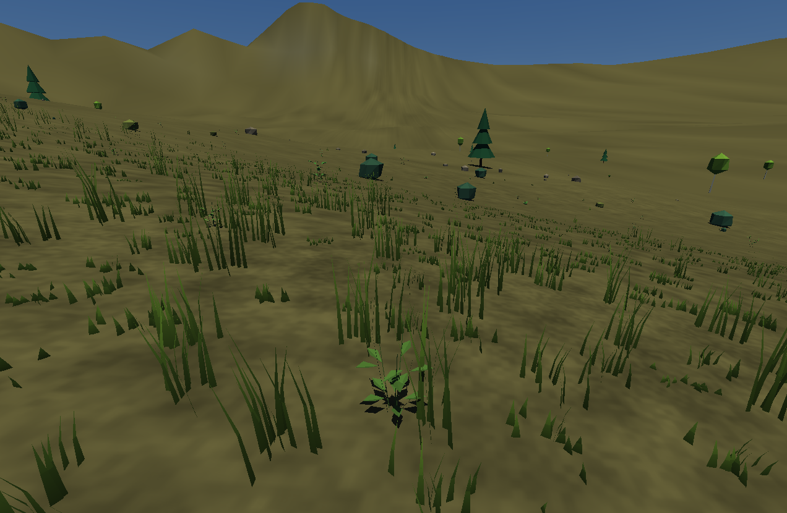
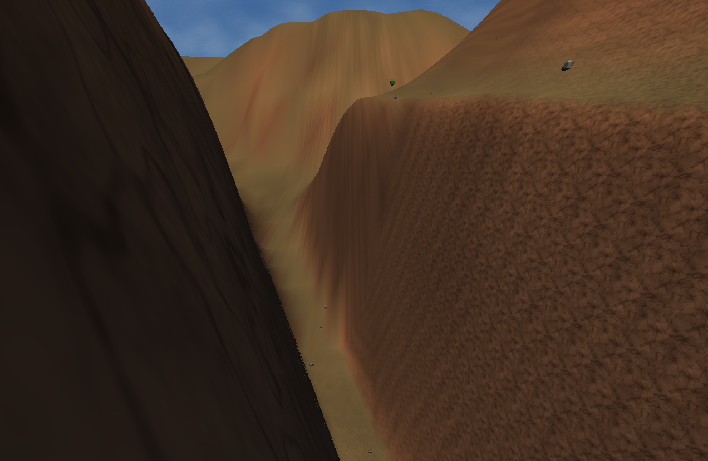
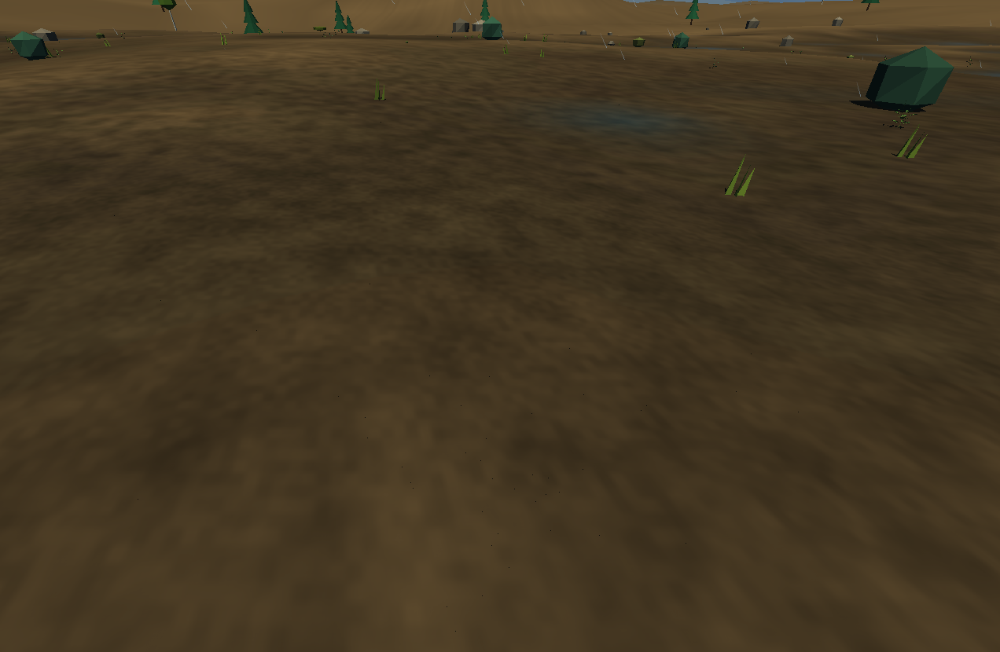
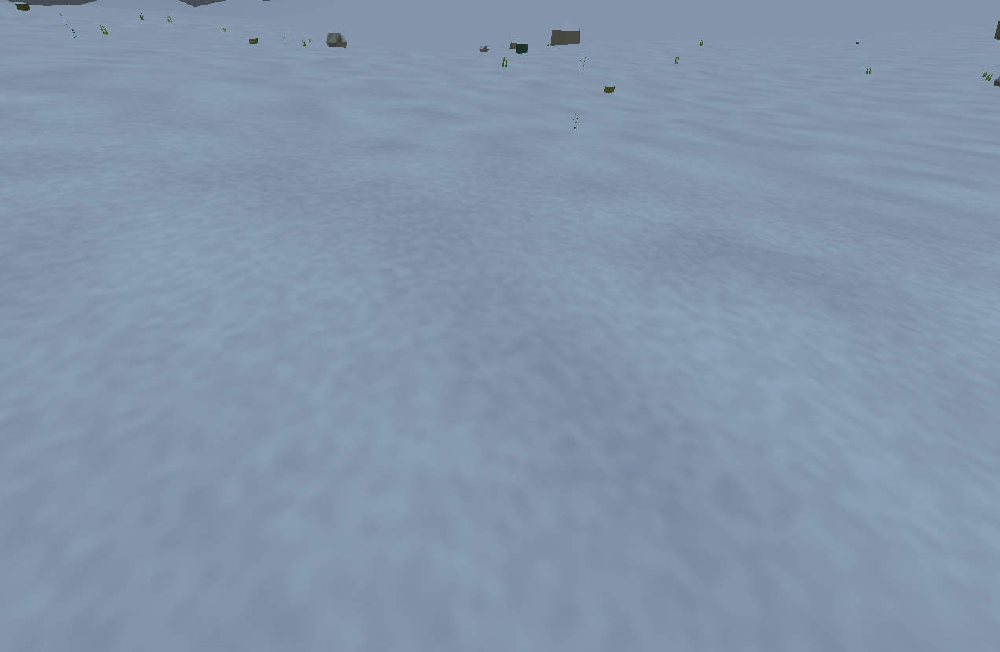

# Скачать PlanetLab 0.27.0

- [Сборка для Windows 10/11 x64](https://github.com/ballentarepuonatrij-del/procedural_world_system/raw/refs/heads/main/releases/PlanetLab-0.27.0-win64.zip)
- [Исходники C++20 для Visual Studio 2026](https://github.com/ballentarepuonatrij-del/procedural_world_system/raw/refs/heads/main/releases/PlanetLab-0.27.0-source.zip)
- [Контрольные суммы SHA-256](SHA256SUMS.txt)

Размер загрузки для Windows составляет около 2,6 МБ. Распакуйте архив и запустите `PlanetLab/PlanetLab.exe`. Осмотреть лиственные деревья можно командой `PlanetLab.exe --grove --solar-hour 12`, хвойный лес — командой `PlanetLab.exe --forest taiga`. Клавиша **X** переключает леса, **P** ставит время на паузу.

## Ветвистые деревья 0.27.0

У лиственных деревьев ствол делится на сучья, развилки и облиственные побеги. Ива опускает наружные ветви, акация расправляет их вширь. Сосна и ель несут хвою на отдельных ветвях. Та же геометрия работает в режиме CPU и при отключённом движении. Деревья из прежних слотов восстанавливаются на своих местах с новыми кронами.

Дуб и сосна сняты с тех же точек, при одинаковом освещении в обеих версиях.

[Проверки сборки](../docs/VALIDATION.md) · [Замеры производительности](../docs/PERFORMANCE.md) · [Модель деревьев](../docs/SCIENCE.md)

Предыдущие версии доступны в архиве. [Windows 0.26.0](PlanetLab-0.26.0-win64.zip) · [Исходники 0.26.0](PlanetLab-0.26.0-source.zip) · [Windows 0.25.0](PlanetLab-0.25.0-win64.zip) · [Исходники 0.25.0](PlanetLab-0.25.0-source.zip) · [Windows 0.24.0](PlanetLab-0.24.0-win64.zip) · [Исходники 0.24.0](PlanetLab-0.24.0-source.zip)

## Листва 0.26.0

## Лёд и каустика 0.25.0

## Трава 0.23.0

Пять секунд ветра в работающем приложении:

## Материалы 0.22.0

## Снимки версии 0.21.0

## Снимки версии 0.20.0

## Снимки версии 0.19.0

