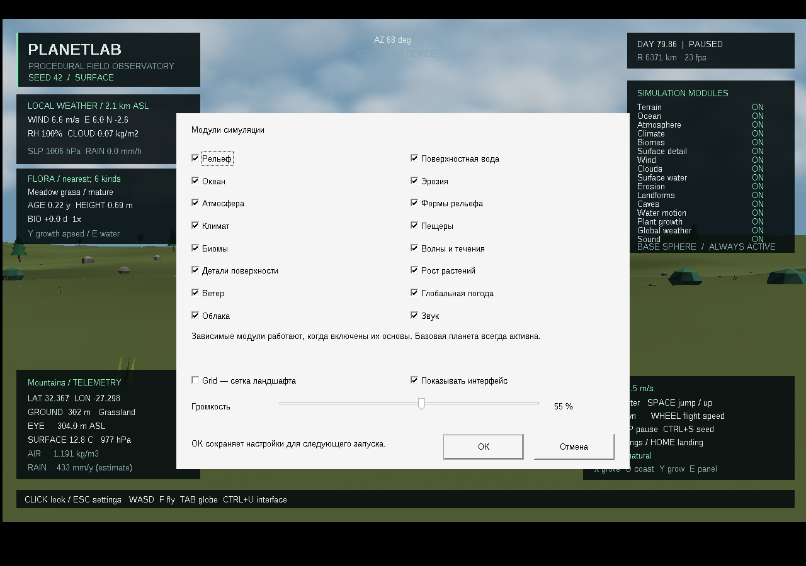
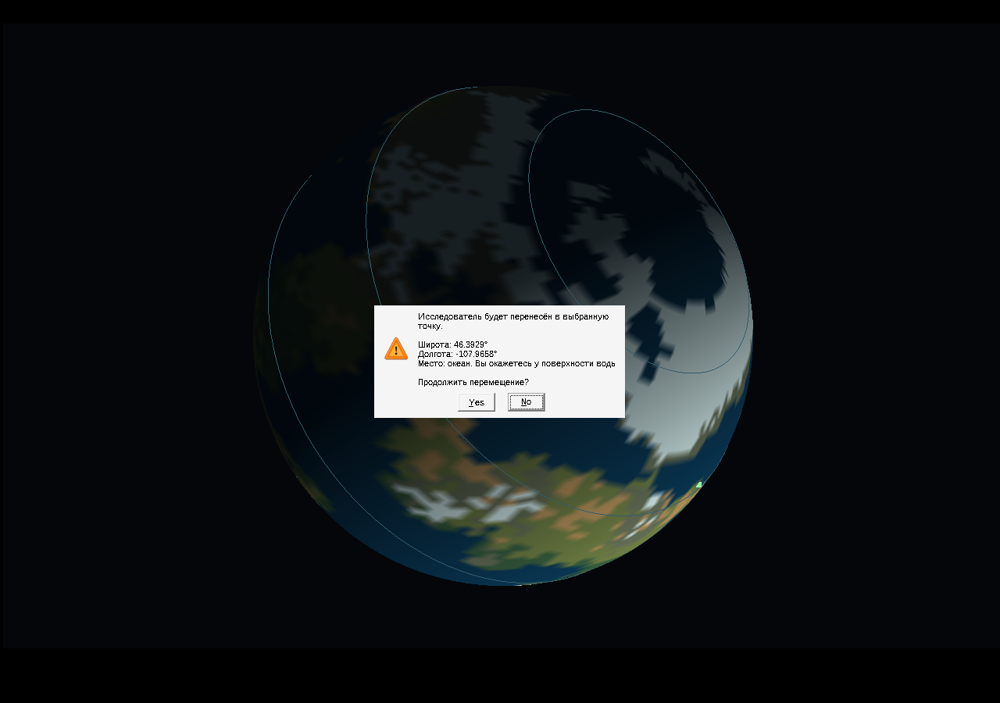

# Скачать PlanetLab 0.11.0

- [Готовая программа для Windows 10/11 x64](https://github.com/ballentarepuonatrij-del/procedural_world_system/raw/refs/heads/main/releases/PlanetLab-0.11.0-win64.zip).
- [Исходники C++20 для Visual Studio 2026](https://github.com/ballentarepuonatrij-del/procedural_world_system/raw/refs/heads/main/releases/PlanetLab-0.11.0-source.zip).

Распакуйте ZIP и запустите `PlanetLab/PlanetLab.exe`. Щёлкните в окне для обзора мышью, используйте WASD. Консольный инструмент `planet_cli.exe` находится рядом.

**Новое в 0.11.0:** сохраняемые настройки и управление глобусом мышью. Grid теперь выключена при первом запуске.

| Действие | Управление |
|---|---|
| Освободить захваченный курсор | Esc |
| Открыть настройки при свободном курсоре | Esc ещё раз |
| Модули, Grid, громкость 0–100%, видимость интерфейса | Окно настроек → ОК |
| Скрыть / вернуть весь интерфейс | Ctrl+U |
| Ввести конкретный seed | Ctrl+S |
| Поверхность / глобус | Tab |
| Вращать глобус | Двигать мышь с зажатой ПКМ |
| Переместиться в выбранную точку | ЛКМ по планете → подтвердить «Да» |
| Ходьба / полёт; берег; роща | F; O; X |
| Посетить тропический циклон → внетропический циклон → грозу | F2 |
| Погодный слой глобуса | F3 |
| Пауза; скорость времени | P; + / − |

ОК применяет и сохраняет настройки. Отмена, Esc и крестик закрывают окно без изменений. Переключатели модулей, Grid и громкости перенесены с прежних горячих клавиш в это окно. Настройки находятся в `%LOCALAPPDATA%\PlanetLab\settings.ini` и восстанавливаются при запуске. Ctrl+U меняет видимость сразу; ОК в настройках запоминает её для следующих запусков.

Глобус открывается со свободным курсором. После вращения щёлкните по видимой поверхности вне панелей интерфейса. Перед перемещением появятся координаты и предупреждение; по умолчанию выбрано «Нет». При подтверждении исследователь окажется на суше или у поверхности воды. Щелчок по фону ничего не делает.

В окне Seed допустимы числа от `0` до `18446744073709551615`. ОК сохраняет число и создаёт новый мир с сохранением модульных настроек. **Смена seed сбрасывает текущее состояние симуляции.** Сохранение погоды, положения исследователя, эрозии и возраста растений между сеансами пока не реализовано.

Поставляется MinGW-w64-сборка. Прошли 123 проверки ядра, санитайзеры и восемь интерактивных сеансов Win32-приложения в Wine. Нативные MSVC v145 и Windows 10/11 здесь не проверялись. Подробности — в [VALIDATION.md](../docs/VALIDATION.md), инструкция сборки и все клавиши — в [основном README](../README.md).

Если GitHub показывает страницу ZIP, нажмите **Download raw file**. Для закрытого репозитория сначала войдите в GitHub. Контрольные суммы — в [SHA256SUMS.txt](SHA256SUMS.txt). Предыдущие архивы сохранены, в том числе [Windows 0.10.0](PlanetLab-0.10.0-win64.zip), [исходники 0.10.0](PlanetLab-0.10.0-source.zip) и [пример процедурной грозы](audio/thunder-0.10.0.wav).

Публикация облачной среды и скачивание приложения — отдельные действия: для запуска достаточно ZIP из GitHub.
