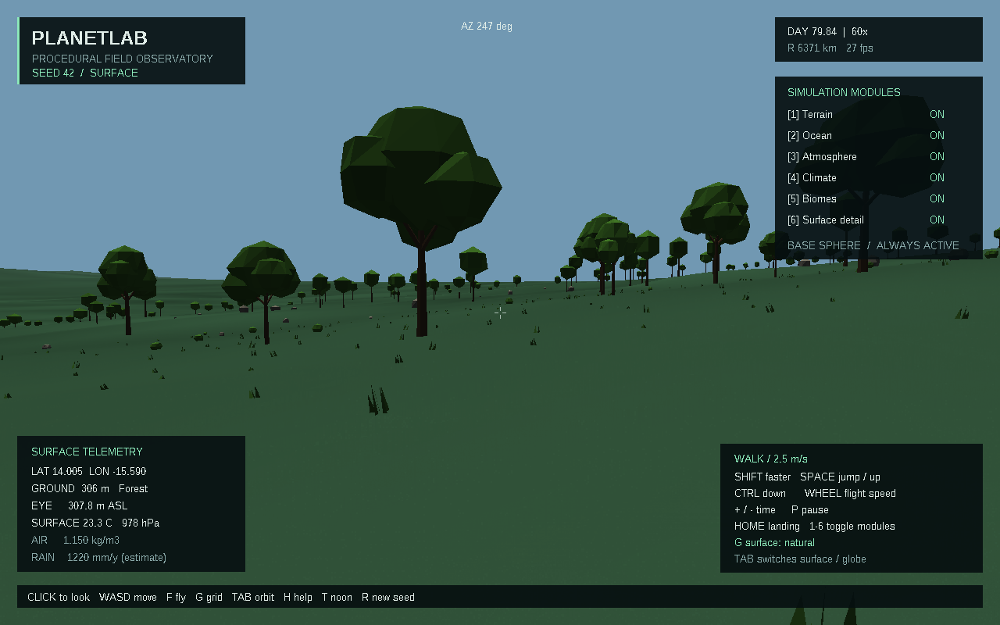
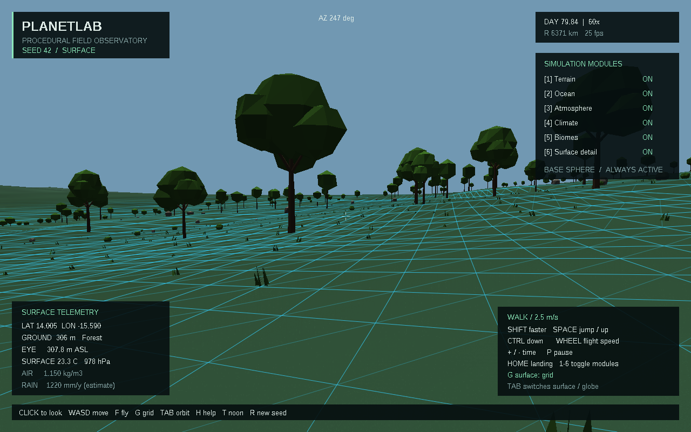
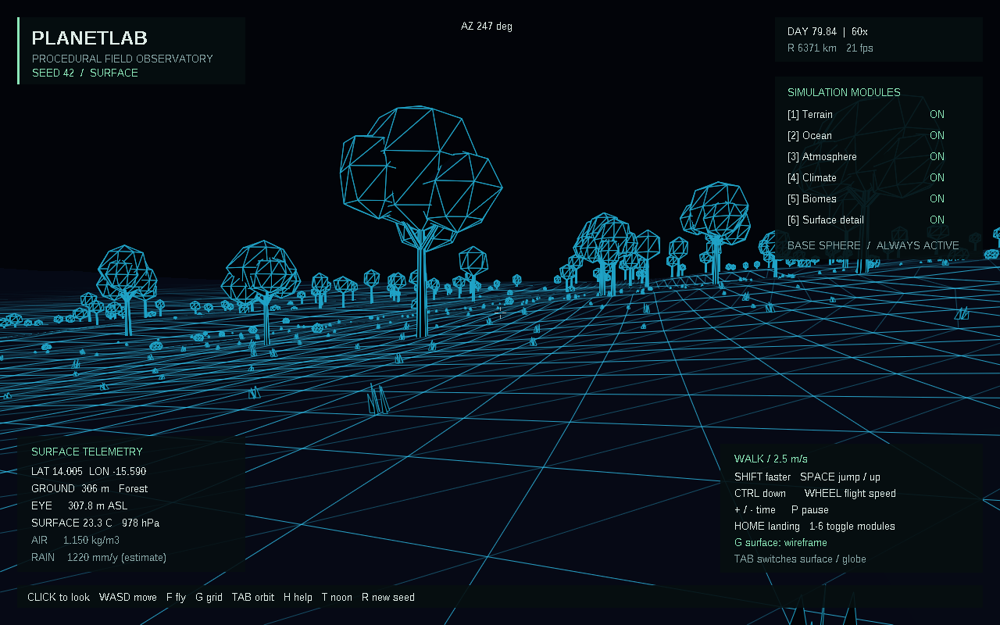

# Скачать PlanetLab 0.3.0

- [Готовая программа для Windows 10/11 x64](https://github.com/ballentarepuonatrij-del/procedural_world_system/raw/refs/heads/main/releases/PlanetLab-0.3.0-win64.zip).
- [Исходники C++20 для Visual Studio 2026](https://github.com/ballentarepuonatrij-del/procedural_world_system/raw/refs/heads/main/releases/PlanetLab-0.3.0-source.zip).

Распакуйте Windows-архив и запустите `PlanetLab/PlanetLab.exe`. Консольный инструмент находится рядом: `planet_cli.exe`. Щёлкните по окну, используйте WASD и мышь; F включает полёт, Tab — обзор планеты, 1–6 переключают модули.

**Новое в 0.3.0:** более подробный рельеф, процедурные камни, деревья, кустарники и трава. Растительность учитывает годовой климат, осадки и уклон; объекты сохраняют положение при движении. Стволы и камни препятствуют ходьбе. Клавиша **6** отключает и возвращает детали поверхности. Геометрия и материалы создаются программно, внешние ассеты не нужны.

Клавиша **G** переключает сетку поверх рельефа → тёмный каркасный вид → обычную поверхность. Сетка включена по умолчанию. Теперь каркас показывает также геометрию объектов. Растительность статическая; её жизненный цикл пока не моделируется.

Обычный вид:

Поверхность с сеткой:

Каркасный вид:

Снимки получены из кадрового буфера приложения. Если GitHub показывает страницу ZIP-файла, нажмите **Download raw file**. Для закрытого репозитория сначала войдите в аккаунт GitHub, которому разрешён доступ.

Контрольные суммы находятся в [SHA256SUMS.txt](SHA256SUMS.txt). Архивы содержат сборку и исходники указанной в имени версии; последующие изменения проекта смотрите в основном дереве репозитория. Предыдущие архивы 0.1.0 и 0.2.0 сохранены в этой же папке.

Инструкция для Visual Studio 2026, ограничения физических моделей и результаты проверок находятся в [основном README](../README.md). Публикация облачной среды и загрузка файлов в GitHub выполняются отдельно.
