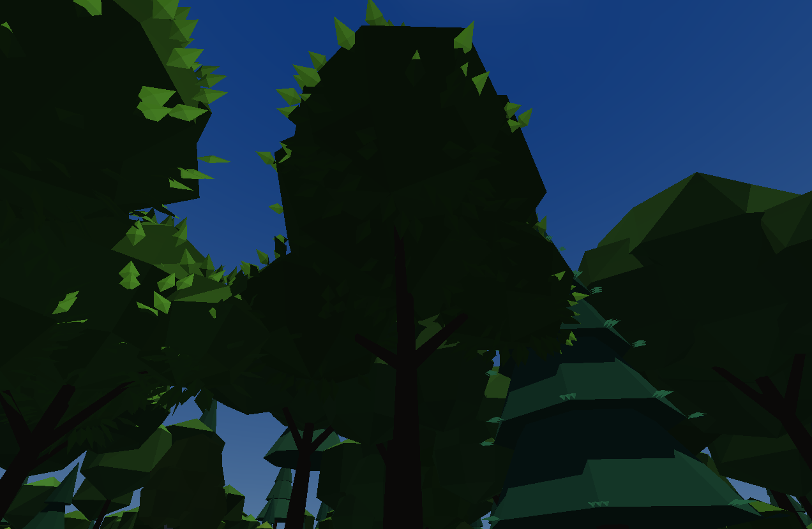
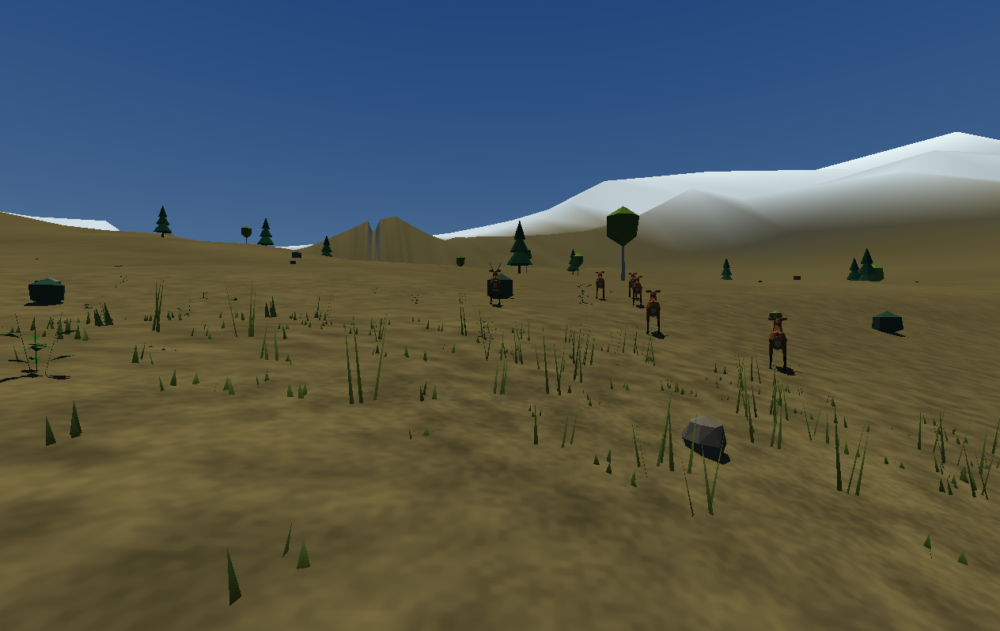
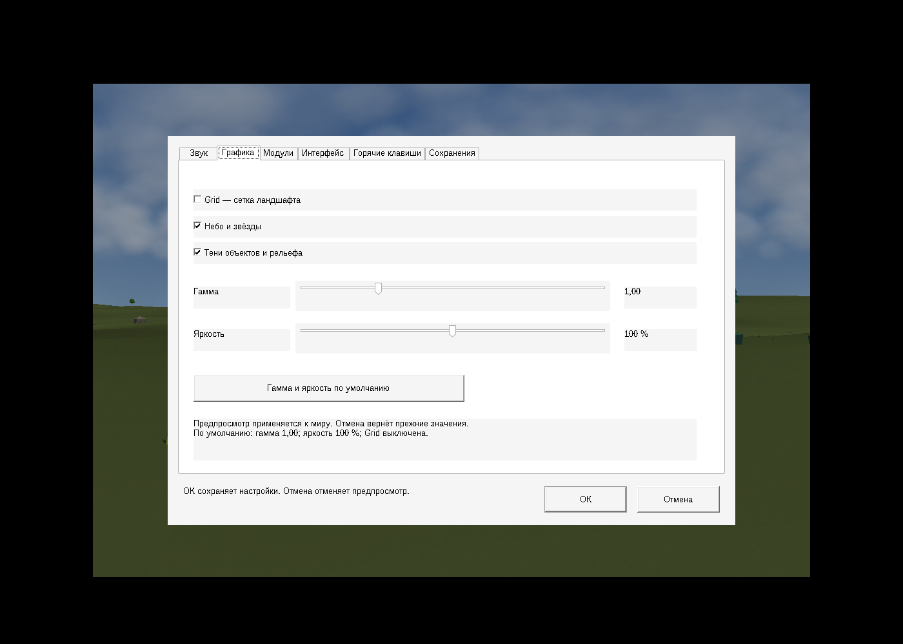
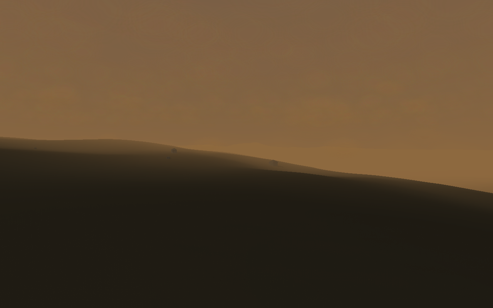
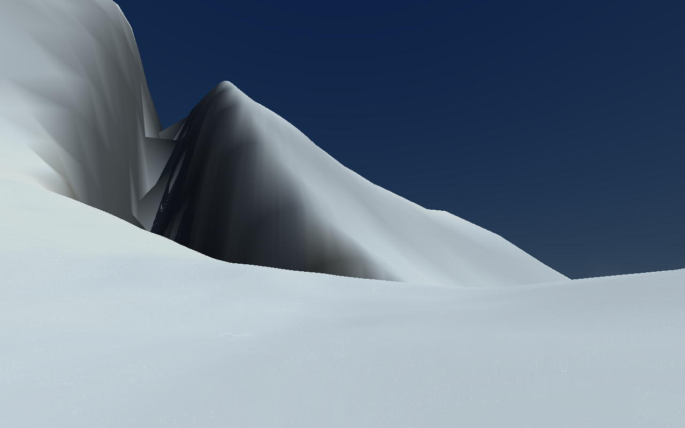

# Скачать PlanetLab 0.26.0

- [Программа для Windows 10/11 x64](https://github.com/ballentarepuonatrij-del/procedural_world_system/raw/refs/heads/main/releases/PlanetLab-0.26.0-win64.zip).
- [Исходники C++20 для Visual Studio 2026](https://github.com/ballentarepuonatrij-del/procedural_world_system/raw/refs/heads/main/releases/PlanetLab-0.26.0-source.zip).

Распакуйте Windows-архив и запустите `PlanetLab/PlanetLab.exe`. ZIP — **2,56 МБ**, распакованный комплект — **8,27 МБ**; исходники — около **469 КБ**.

**Новое:** деревья и кусты качаются на ветру; у ближних крон появились отдельные листья и хвойные побеги. Исследователь и олени отклоняют растения при контакте; ветви упруго возвращаются. Корни закреплены, высокие кроны не реагируют на проход под ними. Трава, вода, лёд и каустика сохранены.

**Попробовать:** `PlanetLab.exe --grove --no-clouds --solar-hour 12`. **X** — другие типы леса, **F8** — луг с кустами, **F11** — стадо, **P** — пауза, **F5/F9** — быстрый слот, **Ctrl+U** — интерфейс.

Анимация ограничена ближайшими растениями и работает на GPU. Без подходящих шейдеров используется ограниченный расчёт на CPU; `--basic-foliage` позволяет его проверить. `--no-foliage-motion` оставляет кроны неподвижными. Тени крон приближённые и не повторяют каждый движущийся лист. Ломание ветвей и опадание листьев пока не моделируются.

Слоты 0.25 читаются без изменения формата; сохраняется чтение старого формата 1. Положение, возраст и поколение растений восстанавливаются, временные изгибы после загрузки сбрасываются. Новых DLL и внешних текстур нет.

Проверки: **255/255** проверок Linux/Windows-ядра, **34/34 CTest**, санитайзеры, анимация, контакты на паузе, сохранение/загрузка и сравнение производительности с опубликованной 0.25.0. Поставляется MinGW-w64-сборка, проверенная в Wine 10; нативные MSVC/Windows и аппаратный GPU здесь не проверялись. [Проверки](../docs/VALIDATION.md), [производительность](../docs/PERFORMANCE.md), [модель](../docs/SCIENCE.md), [SHA-256](SHA256SUMS.txt), [управление](../README.md).

Если GitHub показывает страницу ZIP, нажмите **Download raw file**. Предыдущие версии: [Windows 0.25.0](PlanetLab-0.25.0-win64.zip), [исходники 0.25.0](PlanetLab-0.25.0-source.zip), [Windows 0.24.0](PlanetLab-0.24.0-win64.zip), [исходники 0.24.0](PlanetLab-0.24.0-source.zip).

## Листва 0.26.0

## Лёд и каустика 0.25.0

## Трава 0.23.0

Пять секунд ветра в работающем приложении:

## Материалы 0.22.0

## Снимки версии 0.21.0

## Снимки версии 0.20.0

## Снимки версии 0.19.0

