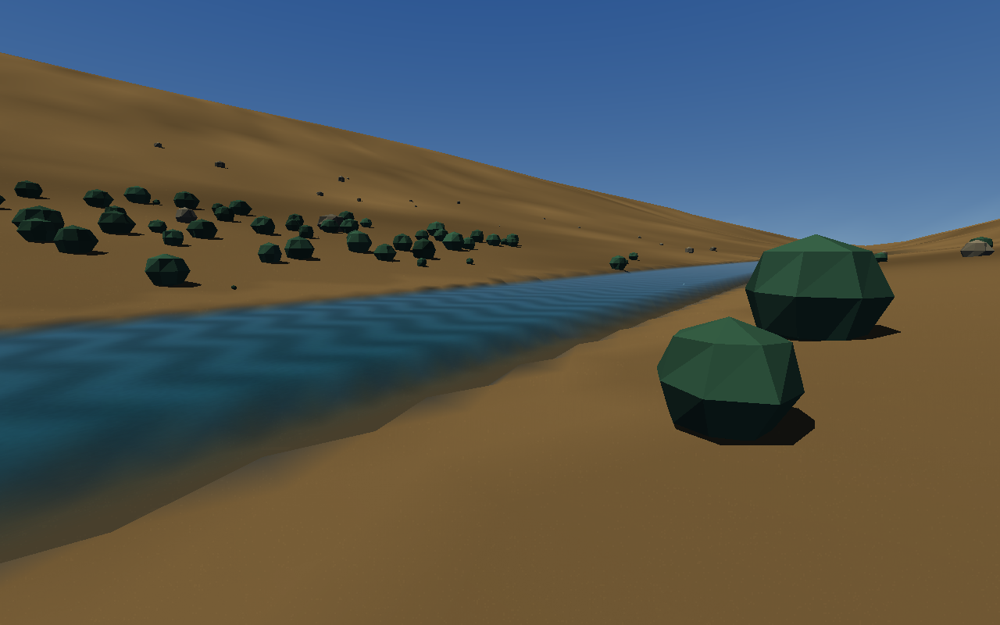
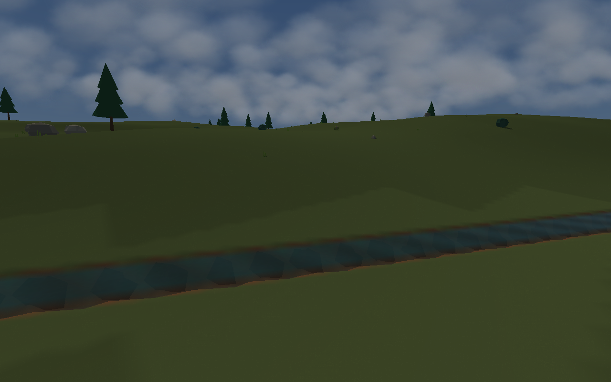
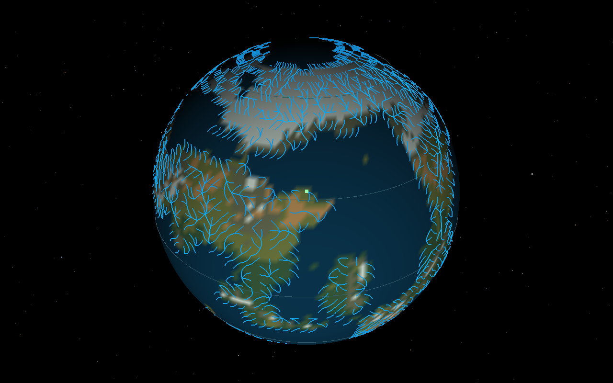
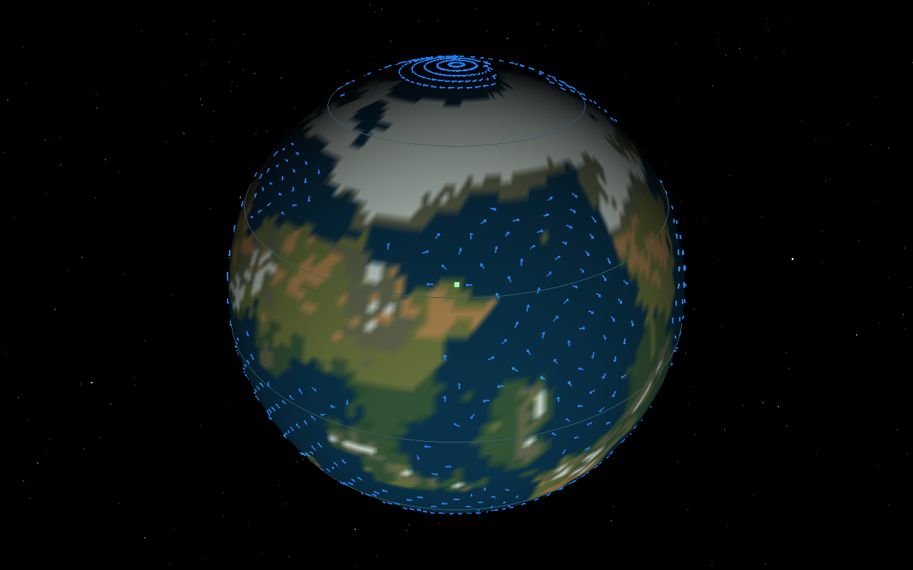
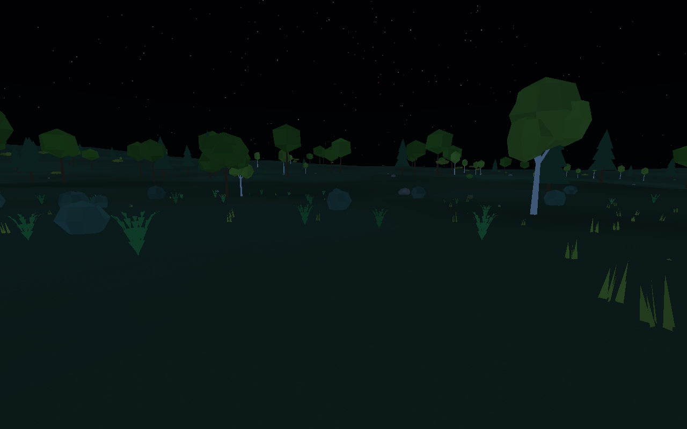
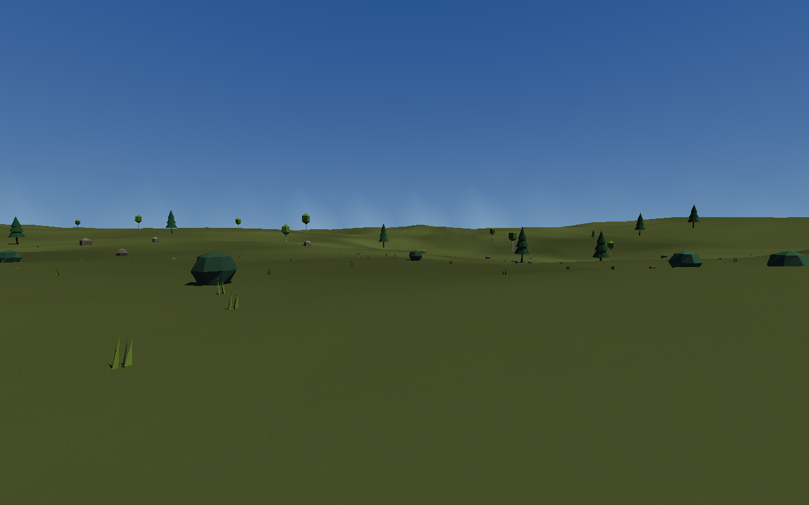
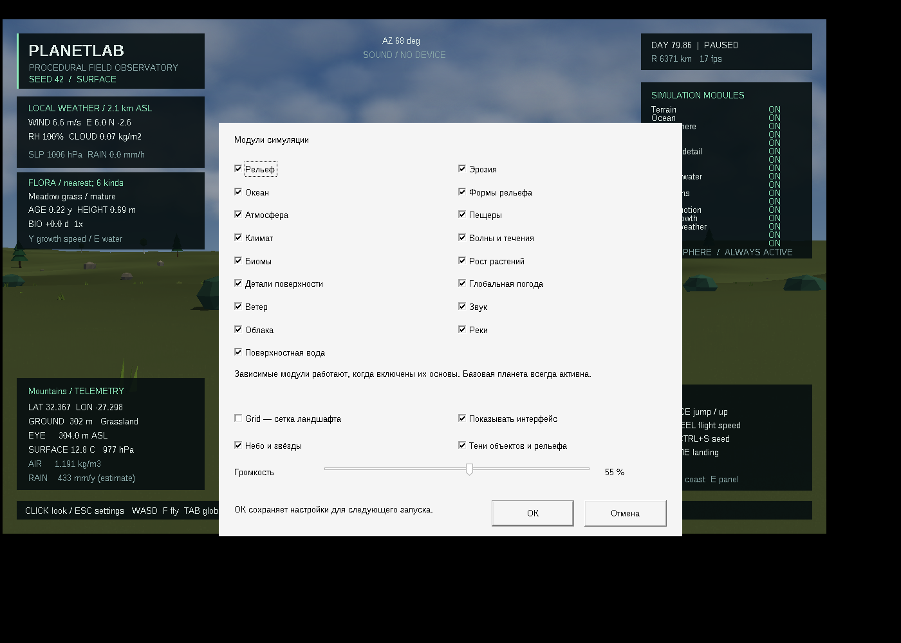

# Скачать PlanetLab 0.13.0

- [Готовая программа для Windows 10/11 x64](https://github.com/ballentarepuonatrij-del/procedural_world_system/raw/refs/heads/main/releases/PlanetLab-0.13.0-win64.zip).
- [Исходники C++20 для Visual Studio 2026](https://github.com/ballentarepuonatrij-del/procedural_world_system/raw/refs/heads/main/releases/PlanetLab-0.13.0-source.zip).

Windows-архив занимает 2,03 МБ, распакованная программа с CLI и документацией — 6,89 МБ.

Распакуйте ZIP и запустите `PlanetLab/PlanetLab.exe`. Щёлкните в окне для обзора мышью, используйте WASD. Консольный инструмент `planet_cli.exe` находится рядом.

**Новое в 0.13.0:** глобальная сеть рек с притоками, большие реки, узкие реки и ручьи; течение, движущаяся рябь и погружение в речную воду. Добавлена фоновая циркуляция океанских бассейнов и два слоя глобуса. Исправлена дальняя рябь теней, усилена видимость поверхности ночью и под густыми облаками.









| Действие | Управление |
|---|---|
| Посетить большую реку → обычную реку → ручей | F7 |
| Поверхность / глобус | Tab |
| Слой глобуса: облака → давление → ветер → реки → течения → выключен | F3 |
| Частицы течения | U |
| Погружение / всплытие | Ctrl / Пробел |
| Пауза / продолжить модельное время | P |
| Освободить захваченный курсор | Esc |
| Открыть настройки при свободном курсоре | Esc ещё раз |
| Модули, в том числе «Реки», Grid, небо, тени, громкость | Настройки → ОК |
| Скрыть / вернуть весь интерфейс | Ctrl+U |
| Ввести конкретный seed | Ctrl+S |
| Вращать глобус | Двигать мышь с зажатой ПКМ |
| Переместиться в выбранную точку | ЛКМ по планете → подтвердить «Да» |
| Ходьба / полёт; берег; роща | F; O; X |
| Посетить ураган → циклон → грозу | F2 |
| Вернуться к солнечному полудню | T |

Для быстрого осмотра:

```powershell
.\PlanetLab.exe --river river --no-clouds
.\PlanetLab.exe --river major --dive-depth 2
.\PlanetLab.exe --globe --weather-layer rivers
```

На первом запуске рассчитывается глобальный атлас. Модуль «Реки» включён по умолчанию; его можно отключить в настройках. «Волны и течения» управляет движением речной и морской воды. На паузе поле скорости сохраняется: пловец продолжает дрейфовать, хотя рябь и модельные процессы остановлены.







Настройки находятся в `%LOCALAPPDATA%\PlanetLab\settings.ini`. Файлы настроек 0.11/0.12 совместимы; новый модуль включится по умолчанию. **ОК** применяет и сохраняет выбор; Отмена, Esc и крестик закрывают окно без изменений. Grid при первом запуске выключена. Включённые реки меняют часть рельефа прежнего seed. Смена seed сбрасывает текущее состояние мира; динамическое сохранение погоды, положения, эрозии и возраста растений между запусками пока отсутствует.

Это этап с климатическим речным стоком и стационарной фоновой океанской циркуляцией. Расходы связаны с бассейнами и средними осадками; глобальные паводки от отдельных гроз, озёра, приливы и термохалинная циркуляция ещё не рассчитаны. Ночная подсветка адаптирована для различимости объектов на экране. Формулы и ограничения — в [SCIENCE.md](../docs/SCIENCE.md).

Поставляется MinGW-w64-сборка. Проверены расчётное ядро, CLI, санитайзеры, графические сцены и управление настоящими клавишами в Wine. Нативные MSVC v145 и Windows 10/11 здесь не проверялись. Подробности — в [VALIDATION.md](../docs/VALIDATION.md), инструкция сборки и все клавиши — в [основном README](../README.md).

Если GitHub показывает страницу ZIP, нажмите **Download raw file**. Для закрытого репозитория сначала войдите в GitHub. Контрольные суммы — в [SHA256SUMS.txt](SHA256SUMS.txt). Предыдущие архивы сохранены, в том числе [Windows 0.12.0](PlanetLab-0.12.0-win64.zip), [исходники 0.12.0](PlanetLab-0.12.0-source.zip) и [пример процедурной грозы](audio/thunder-0.10.0.wav).

Публикация облачной среды и скачивание приложения — отдельные действия: для запуска достаточно ZIP из GitHub.
