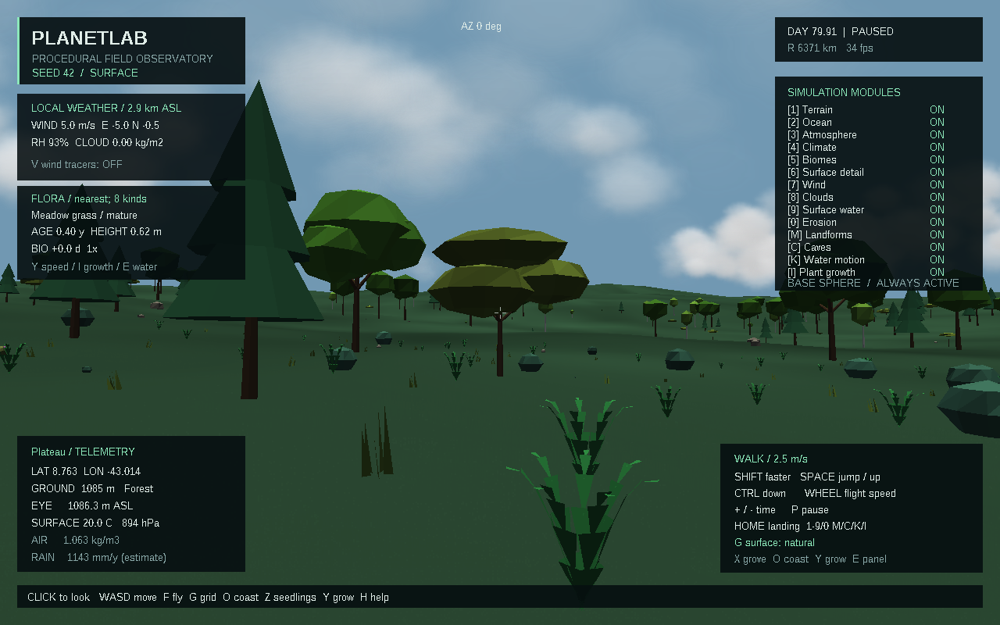
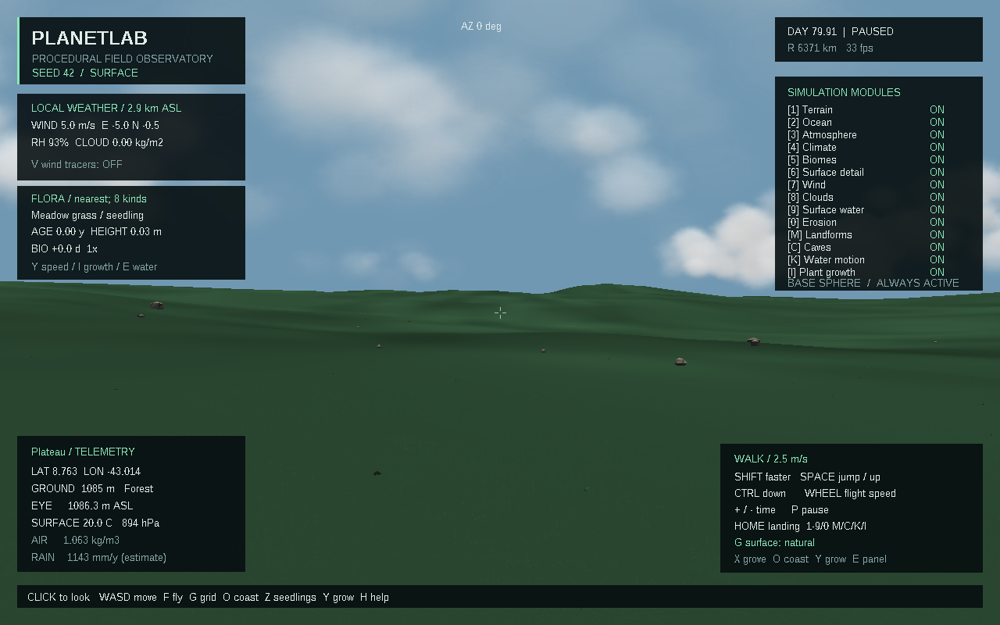
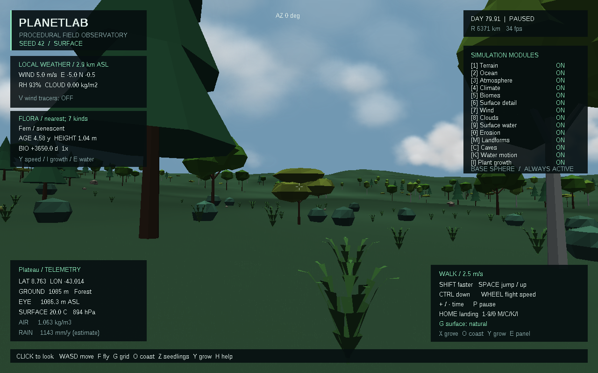
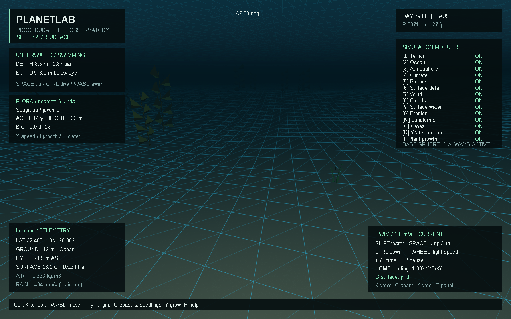

# Скачать PlanetLab 0.8.0

- [Готовая программа для Windows 10/11 x64](https://github.com/ballentarepuonatrij-del/procedural_world_system/raw/refs/heads/main/releases/PlanetLab-0.8.0-win64.zip).
- [Исходники C++20 для Visual Studio 2026](https://github.com/ballentarepuonatrij-del/procedural_world_system/raw/refs/heads/main/releases/PlanetLab-0.8.0-source.zip).

Распакуйте ZIP и запустите `PlanetLab/PlanetLab.exe`. Щёлкните в окне для обзора мышью, используйте WASD. Консольный инструмент `planet_cli.exe` находится рядом.

**Новое в 0.8.0:** девять наземных типов растений и три морских. Растения растут, стареют, отмирают и возобновляются из заданного запаса семян/спор. Возраст и положение сохраняются при уходе с участка в пределах сеанса. Увеличиваются реальные размеры моделей и стволов для столкновений.

| Действие | Клавиша |
|---|---|
| Перейти к роще | X |
| Начать опыт с молодыми растениями | Z |
| Ускорение роста: обычное → день/с → 30 дней/с | Y |
| Остановить/продолжить рост, сохранив растения | I |
| Панель ближайшего растения / воды | E |
| Перейти на берег | O |
| Погрузиться / всплыть | Ctrl / Пробел |
| Фонарь | L |
| Сетка → каркас → обычная поверхность | G |
| Детали поверхности и растительность | 6 |
| Пауза всей модели | P |
| Ходьба / полёт; глобус | F; Tab |

Попробуйте **X → Z → Y → Y**: встаньте в роще, начните с сеянцев и включите быстрый рост. Для удобного сравнения нажмите G до обычного вида; P останавливает наблюдение. Панель FLORA показывает ближайшее растение, его возраст и высоту. X переносит к роще, сохраняя биологическое время; Z явно сбрасывает его и начинает новый опыт.

Скорости Y указаны при основном масштабе 1×. Это отдельное ускорение биологических часов при постоянном среднем климате; облака и вода продолжают свой расчёт. Обычный рост деревьев занимает годы. Реализованы дуб, берёза, сосна, акация, тропическое дерево, можжевельник, вереск, луговая трава, папоротник, морская трава, ламинариевые водоросли и фукус. Последние два — бурые водоросли. Названия обозначают экологические типы, не калиброванные ботанические модели.

Роща с разными типами деревьев и папоротниками:

Тот же участок в опыте с молодыми растениями:

После 3650 биологических дней:

Морская трава и водоросли на дне:

Все снимки сделаны в работающем приложении. Для подводного старта запустите `PlanetLab.exe --dive-depth 9 --wind-m-s 0`; для наблюдения роста — `PlanetLab.exe --grove --young-flora --growth-rate 2592000`.

Пока нет конкуренции, распространения семян между участками, сезонного листопада, углеродного баланса и сохранения сессии на диск. Формулы, параметры и результаты проверок — в [SCIENCE.md](../docs/SCIENCE.md) и [VALIDATION.md](../docs/VALIDATION.md).

Поставляется MinGW-w64-сборка; прошли 90 проверок ядра и проверки интерфейса в Wine. Проект поддерживает сборку Visual Studio 2026. Нативная проверка MSVC v145 и Windows 10/11 в этой среде не выполнялась. Инструкция — в [основном README](../README.md).

Если GitHub показывает страницу ZIP, нажмите **Download raw file**. Для закрытого репозитория сначала войдите в GitHub. Контрольные суммы — в [SHA256SUMS.txt](SHA256SUMS.txt). Предыдущие архивы сохранены.

Публикация облачной среды и скачивание приложения — отдельные действия: для запуска достаточно ZIP из GitHub.
